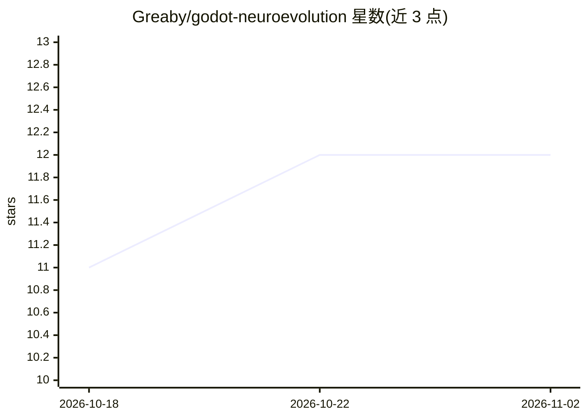

# Greaby/godot-neuroevolution

⭐ 12 · GDScript · MIT · 推送 2026-08-02 · [GitHub](https://github.com/Greaby/godot-neuroevolution) · 个人维护

**Godot 引擎神经进化示例：用进化算法教汽车学习驾驶**

基于 Godot Engine 4.7 的机器学习示例项目：每辆赛车配备传感器与神经网络，初始不会驾驶，通过选取行驶最远的个体进行繁殖（reproduce）与变异（mutate）生成下一代，实现进化算法训练。提供 GDScript API（NeuralNetwork.reproduce / NeuralNetwork.mutate），作者另维护 godot-perceptron 与 godot-neural-network 项目。源码以 MIT 许可发布，需在 Godot 引擎中运行。

## 筛选速览

| 维度 | 判定 | 备注 |
|---|---|---|
| AI 角色 | `ai-native` | 本体是模型或模型工具 |
| 许可风险 | `permissive` | MIT |
| 部署形态 | `None` |  |
| 模型依赖 | — | README 未给出锁定关系 |
| 硬件要求 | — | 无带数字的原话,不猜 |
| 安装摩擦 | `low` | 无编译、无系统依赖或容器化 |
| 成熟度 | — | 结构信号不足 |

## 能力要点

- 传感器+神经网络的赛车个体，按行驶距离择优繁殖
- GDScript API：reproduce 繁殖与 mutate 变异
- 无需初始训练数据的进化算法示例

## 适用场景

- 在 Godot 游戏中实验神经进化算法
- 学习无监督数据场景下的进化训练方法
- 作为游戏 AI 行为学习的参考实现

## 场景标签

`教程课程` · 领域:学习与行业

## 证据(README 行号)

> L10: In this example, cars are driving on a circuit. They have sensors and a neural network. At first the cars don't kno
> L13: This is a form of evolutionary algorithm used in machine learning which is useful when we don't have data at the be

## 星数曲线

2026-10-18 11 → 2026-11-02 12（+1）

---
*卡片 v1 · prompt 1.4 · 生成 2026-11-01 · 置信度 high · 依据 README sha `42451ac14342` · [字段定义](../../DATASET.md)*
