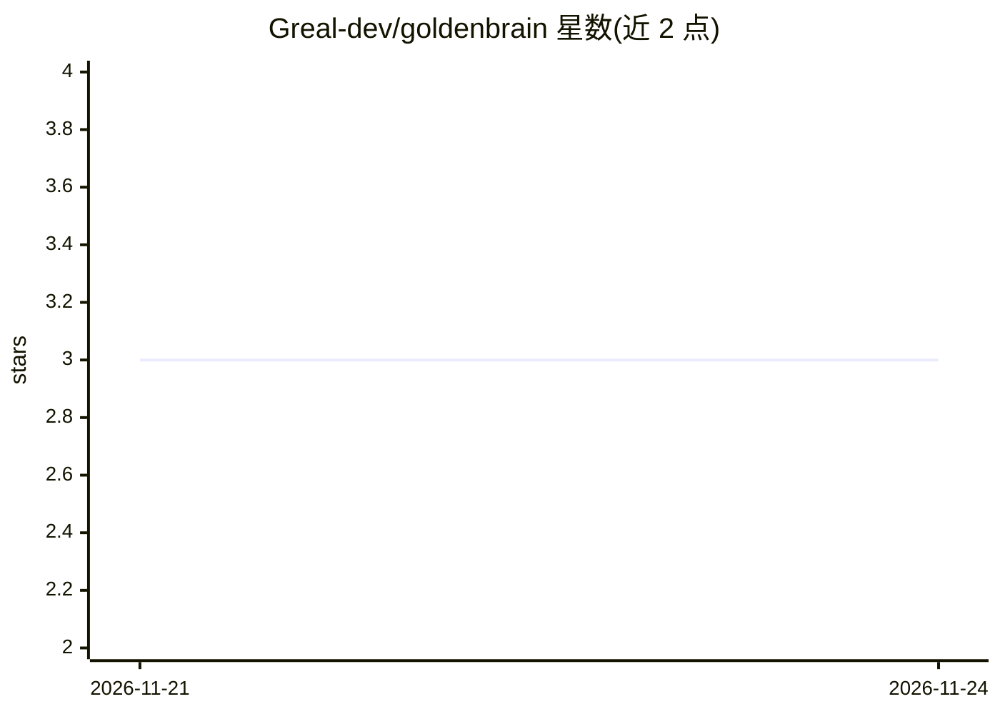

# Greal-dev/goldenbrain

⭐ 3 · Python · Apache-2.0 · 推送 2026-11-23 · [GitHub](https://github.com/Greal-dev/goldenbrain) · 个人维护

**本地的 AI 编码 agent 任务编排台：任务即 Markdown 笔记**

以本地优先方式编排命令行 AI agent 工具（Claude Code、Codex、OpenCode、GitHub Copilot CLI、Antigravity）：每项任务存为 Markdown 库（Obsidian 兼容的普通文件夹）中的笔记，每次执行即一段可随时恢复的原生 agent 会话。提供任务队列、并发上限（固定或按空闲内存）、优先级与前置条件、Me/AI 接管切换、笔记反链与关系图、Telegram 建任务、cron 例行任务与一键更新。单用户单机，服务仅监听 127.0.0.1 且无鉴权，需自行安装并登录至少一个 agent 工具。

## 筛选速览

| 维度 | 判定 | 备注 |
|---|---|---|
| AI 角色 | `ai-ecosystem` | LLM/agent 周边工具 |
| 许可风险 | `permissive` | Apache-2.0 |
| 部署形态 | `desktop` | 安装包/桌面程序 |
| 模型依赖 | — | README 未给出锁定关系 |
| 硬件要求 | — | 无带数字的原话,不猜 |
| 安装摩擦 | `low` | 无编译、无系统依赖或容器化 |
| 成熟度 | — | 结构信号不足 |

## 能力要点

- 任务树级联管理：队列、优先级、前置条件与并发 agent 上限
- 会话与笔记并排显示，agent 摘要卡写入笔记，用户笔记只读不被 agent 改写
- Telegram 文本/照片/语音一键转任务；Tailscale 配对手机访问
- 任一工具可通过 orch.py 或本地 REST API 驱动 GoldenBrain

## 适用场景

- 把编码任务排队分发给多个 agent 会话并集中跟进进度
- 在 Obsidian 式笔记库中让任务、笔记与项目互链成第二大脑
- 通过 Telegram 或手机远程给本机 agent 派活
- 用 cron 例行让 agent 定时执行指令并保留历史

## 场景标签

`编码 Agent` `多智能体` `知识库管理` · 领域:Agent 开发

## 证据(README 行号)

> L5: GoldenBrain is a local control desk for work handed to AI coding agents. Each task is a Markdown note in your vault 
> L69: - **Tasks handed to harnesses**: « Nouvelle tâche » (New task), a title, « Lancer tout de suite » (Launch now). Har
> L81: Any harness (Claude Code, Codex, OpenCode, Gemini CLI…) can steer GoldenBrain through `python orch.py` or the local

## 星数曲线

2026-11-21 3 → 2026-11-24 3（+0）

---
*卡片 v1 · prompt 1.4 · 生成 2026-11-22 · 置信度 mid · 依据 README sha `8b842202973e` · [字段定义](../../DATASET.md)*
