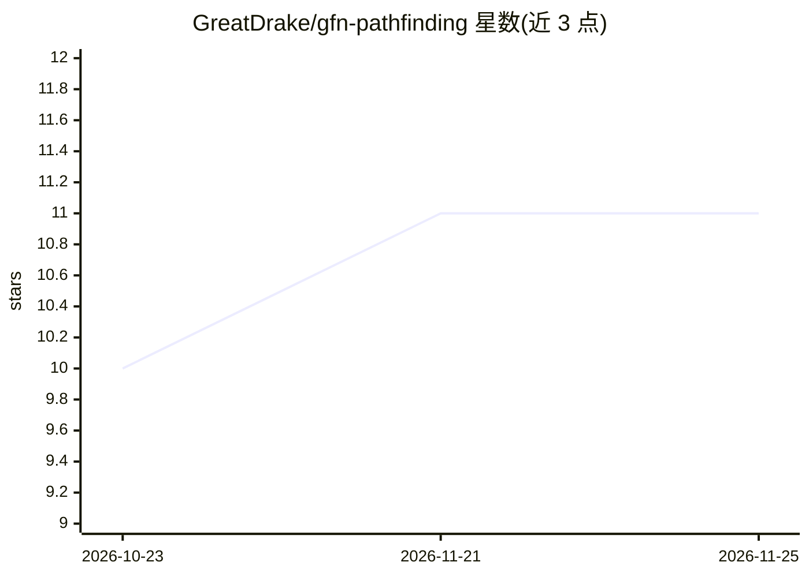

# GreatDrake/gfn-pathfinding

⭐ 11 · Python · MIT · 推送 2026-05-15 · [GitHub](https://github.com/GreatDrake/gfn-pathfinding) · [官网](https://arxiv.org/abs/2603.01786) · 个人维护

**研究者：用 GFlowNet 学习最短路径求解的组合搜索代码库**

论文《Learning Shortest Paths with Generative Flow Networks》的官方代码实现：提供在 2x2x2/3x3x3 魔方与 Swap 任务上训练和评估模型的脚本（train.py/eval.py），基于 JAX/Equinox（权重为 .eqx 格式），训练输出模型文件、评估脚本加载预训练权重并使用 beam search 解题。README 给出各任务的完整命令行参数示例，以及针对解长度改进慢、solve rate 停滞、GPU 显存不足等情形的调参提示。面向复现论文结果或在该框架上做组合搜索研究的科研用户。

## 筛选速览

| 维度 | 判定 | 备注 |
|---|---|---|
| AI 角色 | `ai-native` | 本体是模型或模型工具 |
| 许可风险 | `permissive` | MIT |
| 部署形态 | `None` |  |
| 模型依赖 | — | README 未给出锁定关系 |
| 硬件要求 | — | 无带数字的原话,不猜 |
| 安装摩擦 | `low` | 无编译、无系统依赖或容器化 |
| 成熟度 | — | 结构信号不足 |

## 能力要点

- 论文官方代码：GFlowNet 用于学习最短路径
- 支持 2x2x2/3x3x3 魔方与 Swap 任务的训练与评估
- 评估阶段使用 beam search（--beam_k 参数）
- 提供调参建议与显存拆分评估选项（--test_split_parts）

## 适用场景

- 复现论文中魔方最短路径求解的实验结果
- 在 GFlowNet 框架上研究组合搜索问题
- 加载预训练权重评估模型解题能力

## 场景标签

`科研工具` `强化学习` · 领域:学习与行业

## 证据(README 行号)

> L3: Official code for the paper Learning Shortest Paths with Generative Flow Networks.
> L11: Example of training a model to solve 2x2x2 Rubik’s Cube:
> L14: python train.py --reg_coef 0.01 --hidden_size 1024 --eval_batch_size 100 --use_test_set 1 --test_set_path datasets/

## 星数曲线

2026-10-23 10 → 2026-11-25 11（+1）

---
*卡片 v1 · prompt 1.4 · 生成 2026-11-20 · 置信度 high · 依据 README sha `b3404bce9f0a` · [字段定义](../../DATASET.md)*
