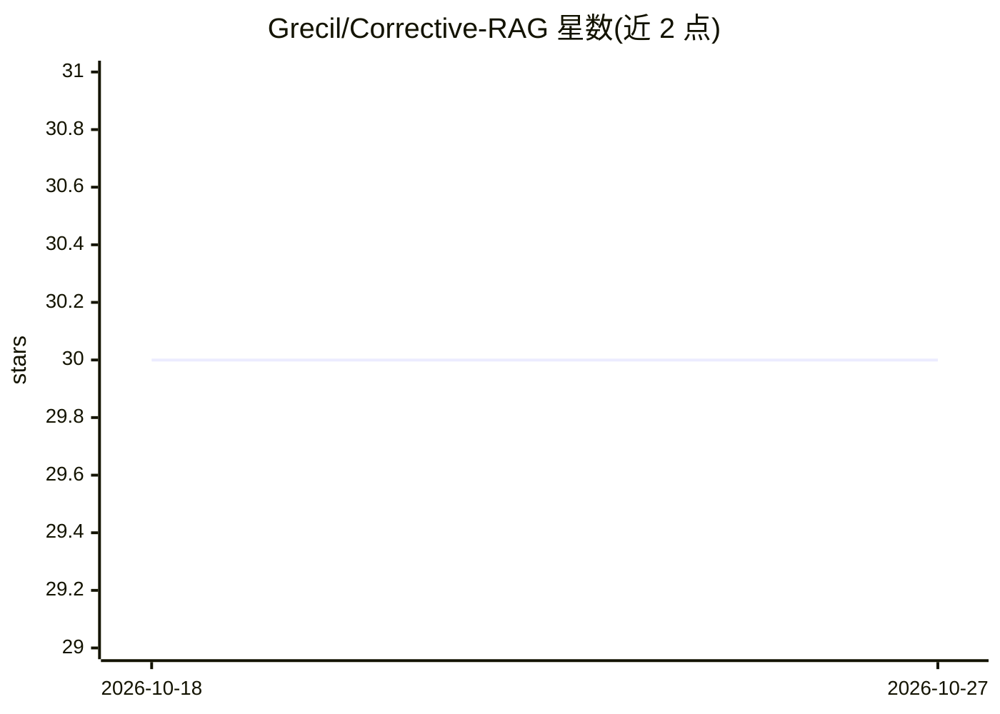

# Grecil/Corrective-RAG

⭐ 30 · Python · 推送 2026-05-13 · [GitHub](https://github.com/Grecil/Corrective-RAG) · [官网](https://crag.grecil.in) · 个人维护

**基于 LangChain/LangGraph 的 Corrective RAG 论文实现，Streamlit 应用**

对论文 Corrective Retrieval Augmented Generation（arXiv:2401.15884）的开源实现，用 LangChain 与 LangGraph 构建，前端为 Streamlit。默认 LLM 为 gemini-1.5-flash，默认嵌入模型为 text-embedding-004，可在 models/ 下替换为 LangChain 支持的其他模型；向量库使用 FAISS，并支持 DuckDuckGo 检索。需 Python 3.10 与 requirements.txt 依赖，也可用 Docker 构建。文档列出待办项（混合搜索、Pinecone、聊天历史等），为开发中的项目。

## 筛选速览

| 维度 | 判定 | 备注 |
|---|---|---|
| AI 角色 | `ai-ecosystem` | LLM/agent 周边工具 |
| 许可风险 | `none` | — |
| 部署形态 | `self-host` | docker 或自建部署 |
| 模型依赖 | — | README 未给出锁定关系 |
| 硬件要求 | — | 无带数字的原话,不猜 |
| 安装摩擦 | `low` | 无编译、无系统依赖或容器化 |
| 成熟度 | — | 结构信号不足 |

## 能力要点

- LangChain + LangGraph 实现 CRAG 流程
- LLM 与嵌入模型可替换（默认 Gemini 系列）
- 提供 Streamlit Web 界面与在线 Demo
- 支持 Docker 构建

## 适用场景

- 学习或复现 Corrective RAG 论文方法
- 在其基础上替换模型或检索组件做实验
- 通过 Streamlit 界面直接体验 CRAG 问答流程

## 场景标签

`RAG` · 领域:知识与检索

## 证据(README 行号)

> L2: An Implementation of this paper - https://arxiv.org/pdf/2401.15884 using LangChain and LangGraph.
> L5: - Large Language Model (Change it in models/LLM. By default it uses gemini-1.5-flash by Google. You can use any mode

## 星数曲线

2026-10-18 30 → 2026-10-27 30（+0）

---
*卡片 v1 · prompt 1.4 · 生成 2026-10-26 · 置信度 high · 依据 README sha `b78373614b5f` · [字段定义](../../DATASET.md)*
