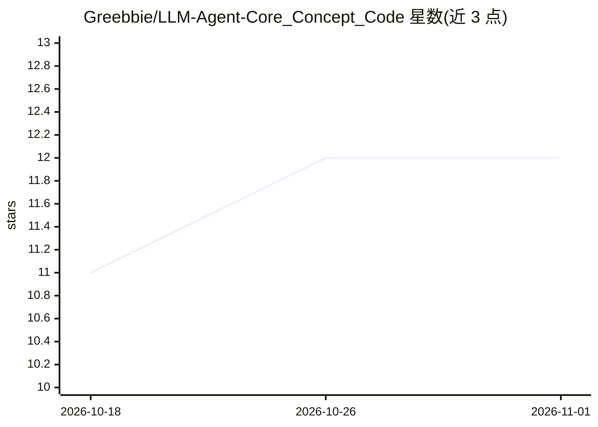

# Greebbie/LLM-Agent-Core_Concept_Code

⭐ 12 · Jupyter Notebook · 推送 2026-05-06 · [GitHub](https://github.com/Greebbie/LLM-Agent-Core_Concept_Code) · 个人维护 · 中文 README

**中文 LLM 与 Agent 实战教程：从 Transformer 原理到可运行 Agent 系统**

以 Jupyter Notebook 为载体的「LLM + Agent」技术教程，主线 13 章覆盖 Autograd/Attention/Transformer 基础、Pretrain→SFT→DPO 训练对齐、KV Cache 推理优化，提供 HuggingFace 工具链（Transformers/PEFT/TRL）与纯 PyTorch 自实现双路线，路线 B 可在 CPU 完整跑通。Applications 部分含 9 个可运行 Agent 案例（ReAct/RAG/Code Agent/Multi-Agent/MCP/Skills/LLMOps/Capstone），LLM 后端抽象支持 Ollama（本地优先）、OpenAI、HuggingFace、vLLM，默认国内 DashScope 配置。面向工程师、学生研究者及产品数据人员，前置要求仅 Python 3.10+，训练章节推荐 NVIDIA GPU。

## 筛选速览

| 维度 | 判定 | 备注 |
|---|---|---|
| AI 角色 | `ai-knowledge` | 知识聚合/清单类 |
| 许可风险 | `none` | — |
| 部署形态 | `library` | 以包/库形式分发 |
| 模型依赖 | local-ok | 支持本地模型 |
| 硬件要求 | — | 无带数字的原话,不猜 |
| 安装摩擦 | `medium` | 含编译或系统依赖之一 |
| 成熟度 | — | 结构信号不足 |

## 能力要点

- 主线 13 章：基础→架构→训练→对齐→推理优化→Agent 落地
- 双路线：HuggingFace 工具链（路线 A）与纯 PyTorch 自建 ~14M GPT（路线 B，CPU 可跑）
- App1-App8 可运行 Agent 案例：ReAct/RAG/Code Agent/Multi-Agent/MCP/Skills/LLMOps
- 统一 utils 抽象层：LLM/Embedding 后端、Multi-Agent 调度器、MCP 封装、Langfuse 可观测性

## 适用场景

- 系统学习 LLM 原理与训练对齐全链路并亲手跑通代码
- 本地用 Ollama 免费跑 ReAct/RAG/多智能体等 Agent 案例
- 用工业工具链（Transformers/PEFT/TRL）完成 SFT/LoRA/DPO 微调实践

## 场景标签

`教程课程` · 领域:学习与行业

## 证据(README 行号)

> L20: 这是一套以 **Jupyter Notebook** 为载体的「LLM + Agent」核心技术实战教程：
> L154: ## 🤖 Applications：Agent 实战案例（重点）

## 星数曲线

2026-10-18 11 → 2026-11-01 12（+1）

---
*卡片 v1 · prompt 1.4 · 生成 2026-11-01 · 置信度 high · 依据 README sha `a678c0512e49` · [字段定义](../../DATASET.md)*
