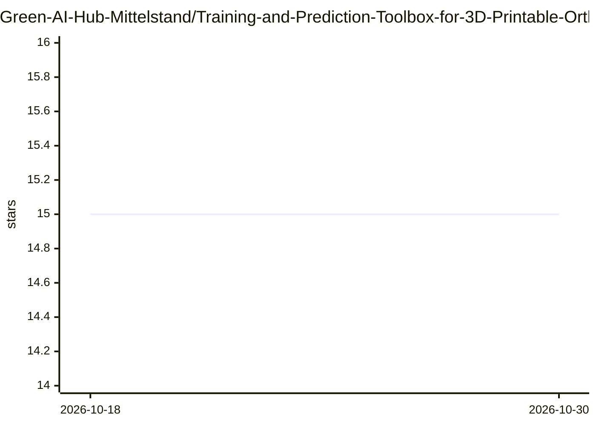

# Green-AI-Hub-Mittelstand/Training-and-Prediction-Toolbox-for-3D-Printable-Orthopedic-Insoles

⭐ 15 · Jupyter Notebook · MIT · 推送 2026-07-23 · [GitHub](https://github.com/Green-AI-Hub-Mittelstand/Training-and-Prediction-Toolbox-for-3D-Printable-Orthopedic-Insoles) · [官网](https://www.green-ai-hub.de/pilotprojekte/pilotprojekt-herges) · 组织维护

**DFKI 开发的矫形鞋垫参数预测工具箱：基于足底压力数据训练模型**

德国人工智能研究中心（DFKI）在 Green-AI Hub Mittelstand 项目下开发的软件栈，与 Herges GmbH 合作完成。工作流程：采集足底压力板数据（pedobarography），由 ML 模型预测鞋垫 3D 模型的关键点与参数（长度、减压位置等），通过 Fusion 360 插件将参数应用到基础模型，再由改版 Orca Slicer 读取填充设置用于 3D 打印。由四个子仓库组成：数据采集与预测、训练用的 Jupyter notebooks、Fusion 插件、适配版 Orca Slicer。不包含鞋垫基础 3D 模型和训练数据，需自行采集。

## 筛选速览

| 维度 | 判定 | 备注 |
|---|---|---|
| AI 角色 | `ai-native` | 本体是模型或模型工具 |
| 许可风险 | `permissive` | MIT |
| 部署形态 | `None` |  |
| 模型依赖 | — | README 未给出锁定关系 |
| 硬件要求 | — | 无带数字的原话,不猜 |
| 安装摩擦 | `low` | 无编译、无系统依赖或容器化 |
| 成熟度 | — | 结构信号不足 |

## 能力要点

- 足底压力数据驱动的鞋垫关键点与参数预测
- 数据采集、标注、预测全流程软件
- Fusion 360 插件直接载入鞋垫参数
- 改版 Orca Slicer 支持从 Fusion 360 Body 名称读取填充参数

## 适用场景

- 矫形鞋垫企业基于足底压力测量自动化生成 3D 打印参数
- 研究团队采集并标注足压数据训练定制模型
- 将预测参数接入 Fusion 360 与切片打印流程

## 场景标签

`模型训练` · 领域:训练与推理

## 证据(README 行号)

> L17: This toolbox was developed by the German Research Center for AI (DFKI) as part of the Green-AI Hub Mittelstand fund
> L19: The project was a collaboration between the DFKI and the Herges GmbH. Its aim was the automatic prediction of param
> L31: The prototype in this repository demonstrates how insoles can be created via a pedobarography. First the customer w

## 星数曲线

2026-10-18 15 → 2026-10-30 15（+0）

---
*卡片 v1 · prompt 1.4 · 生成 2026-10-30 · 置信度 high · 依据 README sha `8575799e039c` · [字段定义](../../DATASET.md)*
