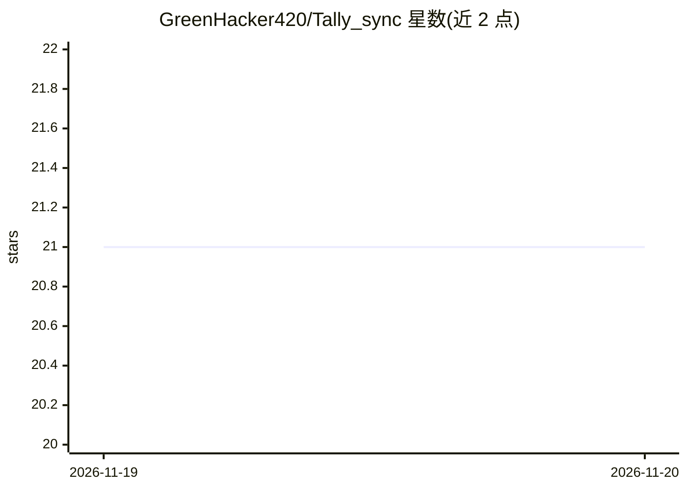

# GreenHacker420/Tally_sync

⭐ 21 · JavaScript · MIT · 推送 2026-11-18 · [GitHub](https://github.com/GreenHacker420/Tally_sync) · 个人维护 · 中文 README

**已停维护的原型：带 Tally ERP 9 同步的云端 ERP 系统**

FinSync360 是一个已声明不再维护的原型项目，定位为带 Tally ERP 9 XML 双向同步的云端 ERP，涵盖凭证记账、GST 合规、库存管理、支付集成、WhatsApp/邮件通知，以及提供支付预测与风险评估的 Python FastAPI ML 微服务。技术栈为 Node.js/Express + MongoDB + React + React Native + Electron，提供 Web/移动/桌面端及后台 Tally 同步 Agent。README 明确指出未经生产加固（幂等过账、崩溃恢复、GST 边界、安全审查），不要连接真实公司账套，并指引使用替代品 tally-sync-ts 或商业版 ShopControl。

## 筛选速览

| 维度 | 判定 | 备注 |
|---|---|---|
| AI 角色 | `ai-enhanced` | 去掉 AI 部分产品仍成立 |
| 许可风险 | `permissive` | MIT |
| 部署形态 | `self-host` | docker 或自建部署 |
| 模型依赖 | — | README 未给出锁定关系 |
| 硬件要求 | — | 无带数字的原话,不猜 |
| 安装摩擦 | `low` | 无编译、无系统依赖或容器化 |
| 成熟度 | `idea` | |

## 能力要点

- 与 Tally ERP 9 的 XML 双向同步引擎及后台 Desktop Agent
- ML 微服务提供支付预测与风险评估
- Web/移动/桌面三端，含 QR/UPI 收款与 GSTN 集成
- 提供 Docker Compose 部署与集成测试脚本

## 适用场景

- 研究旧版 Tally ERP 9 XML 接口的对接方式
- 参考多服务 ERP 系统的架构与部署结构
- 需要 Tally 数据同步库时转向 tally-sync-ts

## 场景标签

`数据分析` · 领域:效率与自动化

## 证据(README 行号)

> L25: A full-stack ERP solution with seamless Tally integration, designed for modern businesses requiring comprehensive f
> L43: - ✅ **ML Service**: AI-powered predictions and analytics
> L57: - **AI-Powered Business Intelligence** - Payment predictions and risk assessment
> L67: - **AI/ML**: Python FastAPI microservice

## 星数曲线

2026-11-19 21 → 2026-11-20 21（+0）

---
*卡片 v1 · prompt 1.4 · 生成 2026-11-19 · 置信度 mid · 依据 README sha `6658c838d4ce` · [字段定义](../../DATASET.md)*
