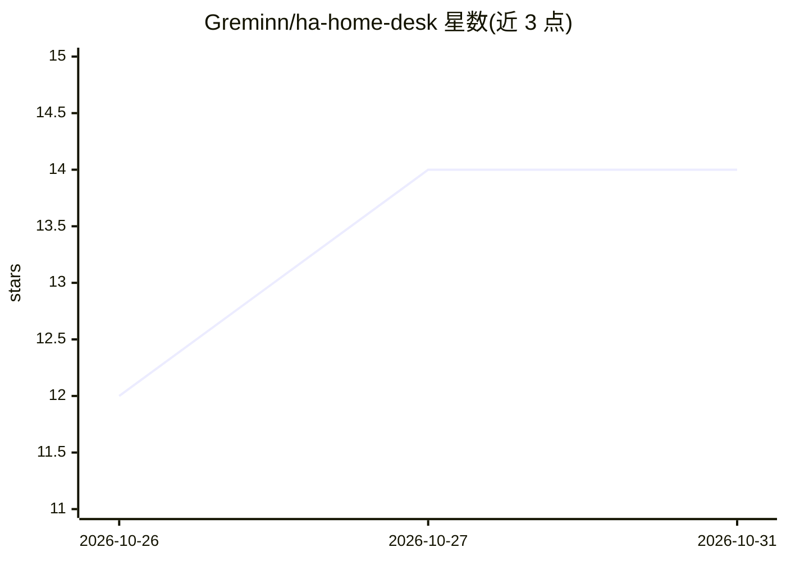

# Greminn/ha-home-desk

⭐ 14 · Python · MIT · 推送 2026-10-29 · [GitHub](https://github.com/Greminn/ha-home-desk) · [官网](https://greminn.github.io/ha-home-desk/) · 个人维护

**Home Assistant 内的家庭工单系统，AI 可选辅助**

以 Home Assistant 自定义集成形式提供的家庭事务工单/helpdesk 系统：家庭成员、AI agent 与 Home Assistant 自身（如 Repairs）可发起工单，覆盖 Inbox/Working/Ideas/Completed 生命周期、优先级、类别、标签与照片/语音报告（语音转写由 Home Assistant 的 speech-to-text 完成）。AI 为可选功能：Review With AI 让所选 AI 给出建议但不能改动任何内容，Queue 可将工单交给用户自运行的 AI agent，设置中有总开关可完全关闭 AI。通过 HACS 自定义仓库或手动复制 custom_components 安装，前端构建产物已提交、无需编译。作者声明为 pre-release，界面可能变动。

## 筛选速览

| 维度 | 判定 | 备注 |
|---|---|---|
| AI 角色 | `ai-enhanced` | 去掉 AI 部分产品仍成立 |
| 许可风险 | `permissive` | MIT |
| 部署形态 | `None` |  |
| 模型依赖 | — | README 未给出锁定关系 |
| 硬件要求 | — | 无带数字的原话,不猜 |
| 安装摩擦 | `low` | 无编译、无系统依赖或容器化 |
| 成熟度 | `idea` | |

## 能力要点

- Home Assistant Repairs 自动转为工单并在修复后自动关闭
- AI 仅建议不改动（Review With AI），且可通过总开关完全关闭
- 家庭成员可用照片与语音报告问题，语音由 Home Assistant speech-to-text 转写
- 提供 home_desk.list_tickets 等服务供助手/自动化读取与处理工单

## 适用场景

- 把家里坏掉的东西和家庭成员的请求记录成带完整历史的工单
- 让 AI 对工单给出第二意见或接手排队处理
- 工单变化时通过事件触发手机通知自动化

## 场景标签

 · 领域:智能家居/家庭自动化

## 证据(README 行号)

> L19: - **AI that advises first.** **Review With AI** asks the AI you chose in Settings to look at a ticket and say what 
> L20: - **AI is optional and has a master switch.** Turn off **Use AI** in Settings and every AI control disappears and H

## 星数曲线

2026-10-26 12 → 2026-10-31 14（+2）

---
*卡片 v1 · prompt 1.4 · 生成 2026-10-31 · 置信度 high · 依据 README sha `024f5251cf97` · [字段定义](../../DATASET.md)*
