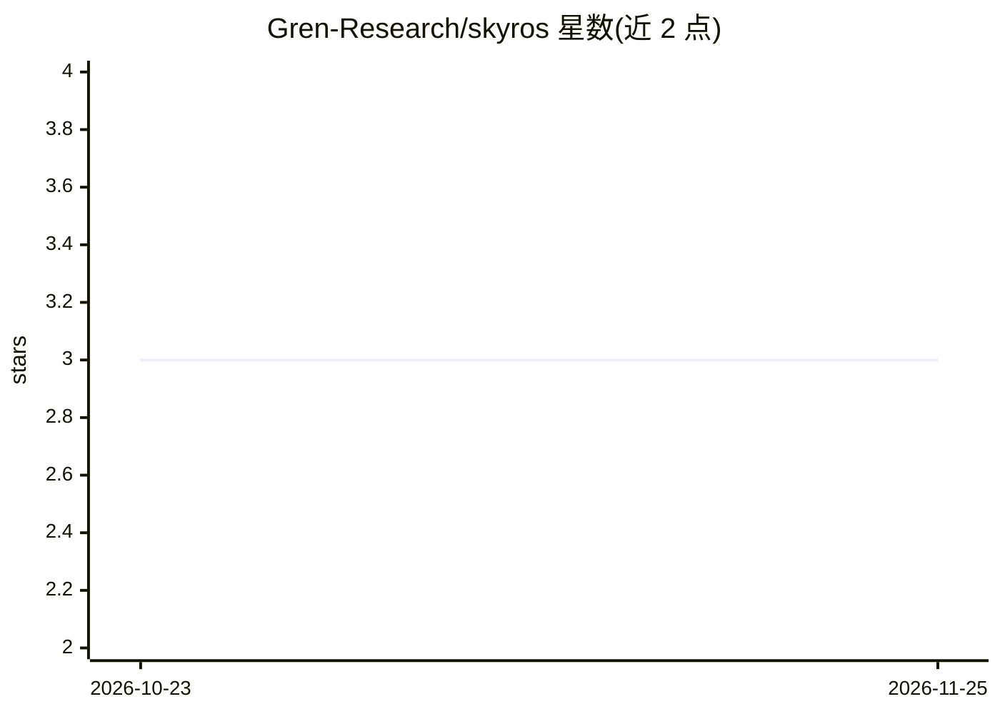

# Gren-Research/skyros

⭐ — · [GitHub]() · 组织维护

**带持久记忆与身份的多智能体运行框架（开发中）**

Skyros 是一个持久化智能体框架：每个 agent 拥有独立的身份、记忆、技能与权限，跨会话保留所学内容。支持多个 agent 并行运行，提供 Research Discussion 机制让不同模型上的多个 agent 实时互相讨论与验证。记忆以本地纯文件存储，可在不同模型与供应商间移植；遵循最小权限、内容仅作数据处理、不自行合并工作等原则。项目处于早期开发阶段，尚无可安装版本，由 AI agent 构建、独立 Reviewer agent 审查、人类 Owner 决策。

## 筛选速览

| 维度 | 判定 | 备注 |
|---|---|---|
| AI 角色 | `ai-ecosystem` | LLM/agent 周边工具 |
| 许可风险 | `permissive` | — |
| 部署形态 | `None` |  |
| 模型依赖 | — | README 未给出锁定关系 |
| 硬件要求 | — | 无带数字的原话,不猜 |
| 安装摩擦 | `low` | 无编译、无系统依赖或容器化 |
| 成熟度 | `idea` | |

## 能力要点

- 每个 agent 具备独立身份、记忆、技能与权限
- 记忆以本地纯文件存储，跨模型/供应商可移植，可读取、修正、删除
- Research Discussion：多个不同模型上的 agent 实时互相讨论与质证
- 无损记录一切，记忆从记录中蒸馏而非替代记录

## 适用场景

- 运行多个各自有记忆与职责的持久 agent（个人助理、熟悉代码库的开发者 agent 等）
- 让多个不同模型的 agent 开会式讨论以产生或验证想法
- 在本地以纯文件形式持有并管理 agent 记忆

## 场景标签

`Agent 记忆` `多智能体` `Agent 框架` · 领域:Agent 开发

## 证据(README 行号)

> L7: Every AI session starts from a blank slate. Skyros is a **harness for persistent agents**: each agent has its own id
> L19: 3. **An agent is its charter, memory, skills and permissions.** The model is the engine; swap it and the agent stay

## 星数曲线

2026-10-23 3 → 2026-11-25 3（+0）

---
*卡片 v1 · prompt 1.4 · 生成 2026-11-22 · 置信度 mid · 依据 README sha `431c185d6d2e` · [字段定义](../../DATASET.md)*
