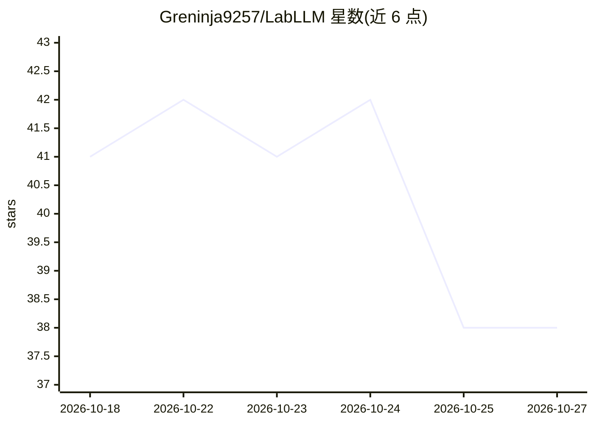

# Greninja9257/LabLLM

⭐ 38 · Swift · MIT · 推送 2026-08-20 · [GitHub](https://github.com/Greninja9257/LabLLM) · [官网](https://greninja9257.github.io/LabLLM/) · 个人维护

**macOS 原生应用：在 Apple Silicon 上从零构建、训练并对话小 LLM**

面向学习与实验场景的免费原生 macOS 应用，把小语言模型训练全流程集于一处：GPT 式模型构建器、Hugging Face 数据集浏览与本地导入、预训练/SFT/LoRA/DPO、训练仪表盘、采样与聊天操场、token 检查、量化导出，并提供本地 OpenAI 形态 HTTP 服务。基于 Apple MLX 与 mlx-swift，全部本地运行，无账号无订阅。要求 macOS 14+ 与 Apple Silicon M1 及以上，当前为 beta 版本，不适用于生产级 LLM 平台场景。

## 筛选速览

| 维度 | 判定 | 备注 |
|---|---|---|
| AI 角色 | `ai-ecosystem` | LLM/agent 周边工具 |
| 许可风险 | `permissive` | MIT |
| 部署形态 | `None` |  |
| 模型依赖 | — | README 未给出锁定关系 |
| 硬件要求 | — | 无带数字的原话,不猜 |
| 安装摩擦 | `low` | 无编译、无系统依赖或容器化 |
| 成熟度 | `idea` | |

## 能力要点

- 从零构建 GPT 式 Transformer 并进行预训练/SFT/LoRA/DPO
- 基于 MLX 的 Apple Silicon 本地训练与推理，数据不出本机
- X-Ray token 检查、嵌入浏览器与 4/8-bit 量化导出
- 本地 OpenAI 形态 HTTP 服务（含流式响应）

## 适用场景

- 在 Mac 上从零训练并微调小语言模型来学习其原理
- 导入自有数据做指令微调并与训练结果对话
- 本地实验采样参数、tokenizer 与 checkpoint 管理

## 场景标签

`微调` `模型训练` `模型量化` · 领域:训练与推理

## 证据(README 行号)

> L30: • build a Transformer from scratch
> L32: • use Apple Silicon + MLX for local training
> L67: It can design a GPT-style model, import text and instruction data, train, fine-tune, sample, chat, save checkpoints

## 星数曲线

2026-10-18 41 → 2026-10-27 38（-3）

---
*卡片 v1 · prompt 1.4 · 生成 2026-10-25 · 置信度 high · 依据 README sha `b16d3805a201` · [字段定义](../../DATASET.md)*
