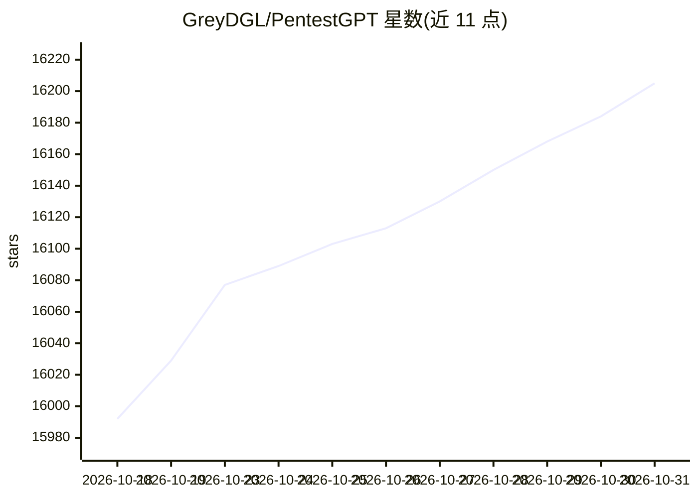

# GreyDGL/PentestGPT

⭐ 16,205 · Python · MIT · 推送 2026-07-14 · [GitHub](https://github.com/GreyDGL/PentestGPT) · 组织维护

**面向渗透测试人员与 CTF 选手的 LLM 自动化测试代理框架**

由 LLM 驱动的自动化渗透测试代理框架，发表于 USENIX Security 2024。v1.0 采用多阶段流水线（CTF：侦察→利用→通关；渗透：资产发现→漏洞识别→报告），前一阶段结果作为下一阶段输入，代理驱动 Claude Code 或 Codex CLI 运行工具并保存/恢复会话。另保留人机交互的 legacy 模式（pentestgpt-legacy），运行推理/生成/解析三个 LLM 会话并维护 Pentesting Task Tree，通过官方 SDK 原生接入 OpenAI、Anthropic、Gemini、DeepSeek、xAI、Qwen、Moonshot 及本地 Ollama。默认收集匿名遥测数据（上传 Langfuse），可用 --no-telemetry 关闭。

## 筛选速览

| 维度 | 判定 | 备注 |
|---|---|---|
| AI 角色 | `ai-native` | 本体是模型或模型工具 |
| 许可风险 | `permissive` | MIT |
| 部署形态 | `self-host` | docker 或自建部署 |
| 模型依赖 | local-ok | 支持本地模型 |
| 硬件要求 | — | 无带数字的原话,不猜 |
| 安装摩擦 | `low` | 无编译、无系统依赖或容器化 |
| 成熟度 | — | 结构信号不足 |

## 动量与使用信号

- 维护:`maintenance` — 距上次 push 95.8 天,年发版 1,23 位贡献者
- 涨星:近 1 天 **+20**(自 20261016 起算)
- 安装:github 包 `release-assets` 月下载无数据
- 平台:— · 协议:OPENAI-API / OLLAMA

## 能力要点

- 多阶段流水线代理，自动驱动 Claude Code 或 Codex CLI 执行工具
- legacy 模式通过官方 SDK 原生支持 8 类提供商及本地 Ollama
- 三个协作 LLM 会话维护 Pentesting Task Tree（PTT）
- Docker 镜像捆绑工具与两个 CLI，登录凭据持久化在卷中

## 适用场景

- 让代理自动完成 CTF 题目的侦察、利用与通关
- 在授权渗透测试中做资产发现、漏洞识别并生成报告
- 本地/云端多模型间切换运行交互式渗透测试会话

## 场景标签

`网络安全` · 领域:学习与行业

## 证据(README 行号)

> L38: - **Multi-Stage Pipeline** - The agent works through staged phases (recon → exploit → walkthrough for CTF; asset di
> L116: pipeline supports Claude and Codex backends; this legacy mode talks **natively** to many providers
> L49: - **AI-Powered Challenge Solver** - Leverages LLM advanced reasoning to perform penetration testing and CTFs

## 星数曲线

2026-10-18 15,992 → 2026-10-31 16,205（+213）

---
*卡片 v1 · prompt 1.4 · 生成 2026-10-18 · 置信度 high · 依据 README sha `64795b4df67c` · [字段定义](../../DATASET.md)*
