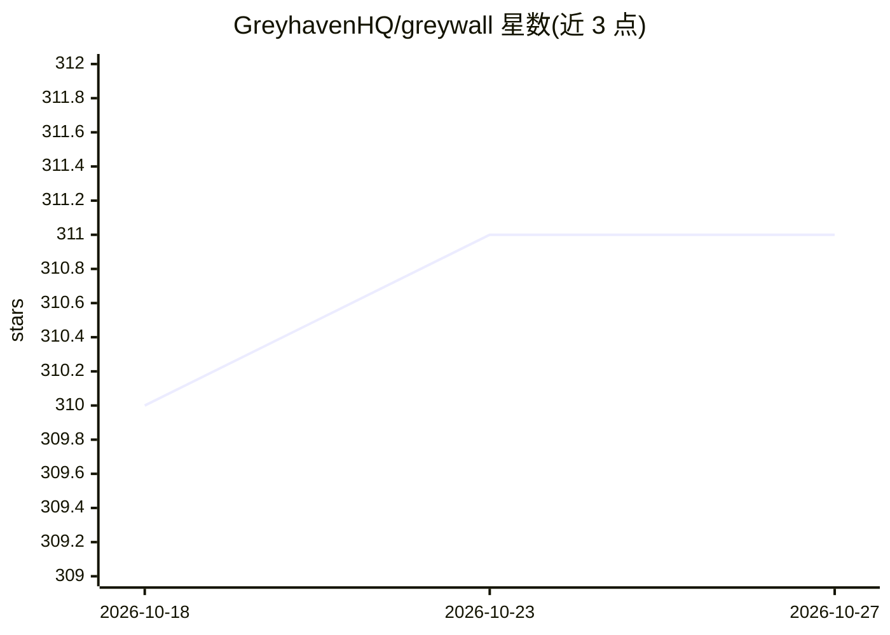

# GreyhavenHQ/greywall

⭐ 311 · Go · Apache-2.0 · 推送 2026-10-17 · [GitHub](https://github.com/GreyhavenHQ/greywall) · [官网](https://greywall.io) · 组织维护

**给开发者的 AI 编程代理沙箱：默认拒绝的文件/网络/系统调用隔离**

面向 Linux/macOS 的无容器沙箱工具，用于隔离 Claude Code、Cursor、Codex 等 AI 编程代理的运行。默认拒绝文件系统访问、网络连接与危险命令，仅放行显式允许的路径；网络流量经内置透明代理 greyproxy 转发并在仪表盘可视化。Linux 侧组合 bubblewrap、Landlock、Seccomp、eBPF 与 TUN 五层机制，macOS 使用 Seatbelt。附带学习模式（strace/eslogger 追踪生成最小权限配置）与观察模式 greywatch（全放行仅记录），内置十余种代理与工具链配置。

## 筛选速览

| 维度 | 判定 | 备注 |
|---|---|---|
| AI 角色 | `ai-ecosystem` | LLM/agent 周边工具 |
| 许可风险 | `permissive` | Apache-2.0 |
| 部署形态 | `library` | 以包/库形式分发 |
| 模型依赖 | — | README 未给出锁定关系 |
| 硬件要求 | — | 无带数字的原话,不猜 |
| 安装摩擦 | `low` | 无编译、无系统依赖或容器化 |
| 成熟度 | — | 结构信号不足 |

## 能力要点

- 默认拒绝的文件系统、网络与系统调用隔离，无需容器
- 网络流量经 greyproxy 透明代理并带实时允许/拒绝仪表盘
- 学习模式追踪命令访问并自动生成最小权限配置文件
- 内置 Claude Code、Cursor、Codex 等代理及 Node/Python 等工具链配置

## 适用场景

- 在沙箱中运行 AI 编程代理，防止其访问 SSH 密钥与工作目录外的文件
- 先以观察模式查看代理实际行为，再决定锁定范围
- 自动生成代理所需的最小权限配置

## 场景标签

`网络安全` · 领域:学习与行业

## 证据(README 行号)

> L11: - **`greywall` — deny-by-default sandbox.** Restricts filesystem access, network connections, and system calls to o
> L25: - **Built-in agent profiles** — one-command setup for Claude Code, Cursor, Codex, Aider, Goose, Gemini, OpenCode, A
> L28: - **Five security layers on Linux** — Bubblewrap namespaces, Landlock, Seccomp BPF, eBPF monitoring, TUN-based netw

## 星数曲线

2026-10-18 310 → 2026-10-27 311（+1）

---
*卡片 v1 · prompt 1.4 · 生成 2026-10-23 · 置信度 high · 依据 README sha `63477d44cdc5` · [字段定义](../../DATASET.md)*
