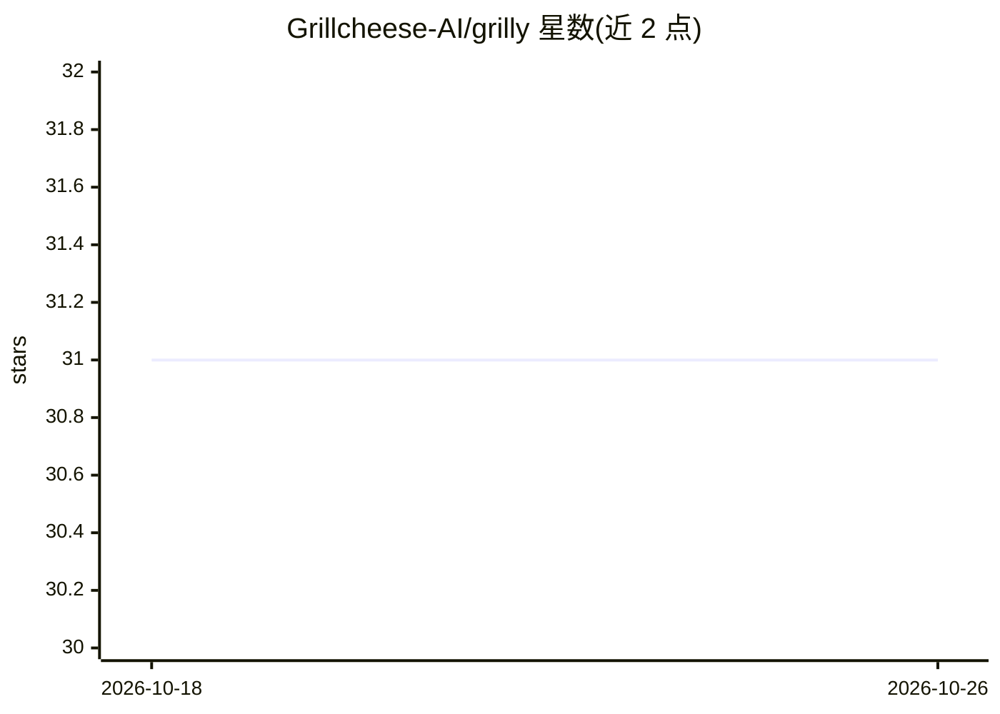

# Grillcheese-AI/grilly

⭐ 31 · Python · MIT · 推送 2026-07-29 · [GitHub](https://github.com/Grillcheese-AI/grilly) · 组织维护

**基于 Vulkan 计算着色器的跨厂商 GPU 深度学习框架**

面向需要非 CUDA 后端的研究开发者的神经网络框架：用 231 个 GLSL 计算着色器（编译为 SPIR-V）经原生 C++ 层调度，在 AMD/NVIDIA/Intel GPU 上运行，提供 PyTorch 风格的 nn.Module/autograd/优化器 API。无 GPU 时自动回退到 NumPy CPU 或 PyTorch CUDA。包含 100+ 层、脉冲神经网络、VSA/MoE/时序推理等实验模块。核心依赖仅 numpy。README 声明当前为 pre-v1.0 状态，main 分支较 v0.6.1 大规模重写，旧代码可能需要更新。

## 筛选速览

| 维度 | 判定 | 备注 |
|---|---|---|
| AI 角色 | `ai-ecosystem` | LLM/agent 周边工具 |
| 许可风险 | `permissive` | MIT |
| 部署形态 | `library` | 以包/库形式分发 |
| 模型依赖 | — | README 未给出锁定关系 |
| 硬件要求 | `gpu-8g` | |
| 安装摩擦 | `high` | 编译与系统依赖俱全 |
| 成熟度 | `idea` | |

## 能力要点

- 231 个 Vulkan SPIR-V 计算内核，支持 AMD/NVIDIA/Intel，无 CUDA 依赖
- 三级回退：Vulkan 原生 → PyTorch CUDA → NumPy CPU，同一 API
- 100+ 层、FlashAttention、LoRA、脉冲神经网络与 VSA/MoE 等实验模块
- GPU 加速需自行编译 C++ 扩展，Python-only 安装仅 CPU 回退路径

## 适用场景

- 在 AMD/Intel GPU 上训练和运行神经网络而不依赖 CUDA
- 研究脉冲神经网络、VSA、认知控制器等非主流架构
- 在 Colab 或无 CUDA 环境做 GPU 加速实验

## 场景标签

`模型训练` · 领域:训练与推理

## 证据(README 行号)

> L13: GPU-accelerated neural network framework using **Vulkan compute shaders**. PyTorch-like API that runs on **any GPU*
> L246: ## Architecture
> L259: Every operation has automatic fallback:

## 星数曲线

2026-10-18 31 → 2026-10-26 31（+0）

---
*卡片 v1 · prompt 1.4 · 生成 2026-10-26 · 置信度 high · 依据 README sha `46b663753b1d` · [字段定义](../../DATASET.md)*
