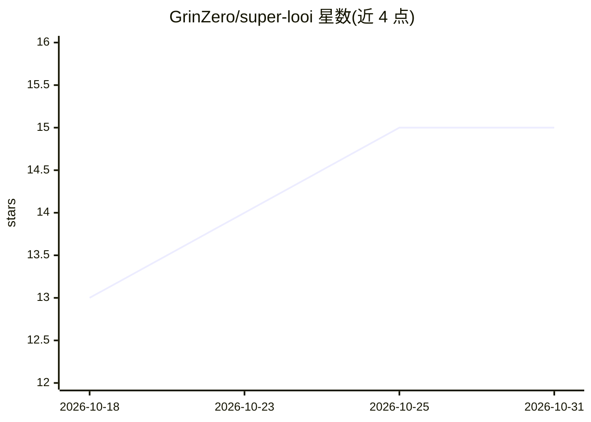

# GrinZero/super-looi

⭐ 15 · TypeScript · MIT · 推送 2026-06-30 · [GitHub](https://github.com/GrinZero/super-looi) · 个人维护 · 中文 README

**面向 LOOI 机器人的本地优先 BLE 控制 SDK 及配套 Expo 应用**

monorepo 包含三部分：`@sourcebug/looi-sdk`（早期 alpha 的 TypeScript SDK，封装 LOOI 机器人的高层运动、头部位置、灯光、吸附状态回调与 raw BLE 写入）、React Native/Expo 应用（验证语音、记忆、感知与身体控制组合体验）以及本地 server（提供记忆、LLM 编排、会话与设备工具调用 API）。本地视觉服务基于 llama.cpp Metal 构建运行 MiniCPM-V 2.6 GGUF 模型；需 Node.js+pnpm、Docker Compose，配置 LLM_API_KEY 与 MiniMax 凭据。SDK 标注为早期 alpha，行为可能变化。

## 筛选速览

| 维度 | 判定 | 备注 |
|---|---|---|
| AI 角色 | `ai-enhanced` | 去掉 AI 部分产品仍成立 |
| 许可风险 | `permissive` | MIT |
| 部署形态 | `self-host` | docker 或自建部署 |
| 模型依赖 | local-ok | 支持本地模型 |
| 硬件要求 | — | 无带数字的原话,不猜 |
| 安装摩擦 | `low` | 无编译、无系统依赖或容器化 |
| 成熟度 | `idea` | |

## 能力要点

- looi-sdk 封装 BLE 控制：高层运动、头部、灯光、吸附回调与 raw 写入
- 本地 server 提供记忆、LLM 编排、会话与设备工具调用 API
- 视觉服务基于 llama.cpp Metal + MiniCPM-V 2.6 GGUF 本地运行
- 中英双语 README，含验收记录与 smoke test 脚本

## 适用场景

- 通过 TypeScript/Web Bluetooth 控制 LOOI 机器人本体
- 在移动端组合语音、记忆、感知驱动机器人完整体验
- 本地部署视觉模型做机器人感知实验

## 场景标签

`语音 Agent` · 领域:对话与助手

## 证据(README 行号)

> L7: Super LOOI 是一个以 **looi-sdk** 为核心、面向 LOOI Robot 的本地优先实验仓库。当前仓库同时包含：
> L9: - `packages/looi-sdk`：早期提供的核心之一，封装 LOOI Robot 的 BLE 控制能力。
> L11: - `server`：本地服务端，提供记忆、LLM、会话和设备工具调用等能力。
> L135: - React Native / Expo app: one application scenario for `looi-sdk`, validating how voice, memory, perception, and 

## 星数曲线

2026-10-18 13 → 2026-10-31 15（+2）

---
*卡片 v1 · prompt 1.4 · 生成 2026-10-30 · 置信度 high · 依据 README sha `11769dae3fe9` · [字段定义](../../DATASET.md)*
