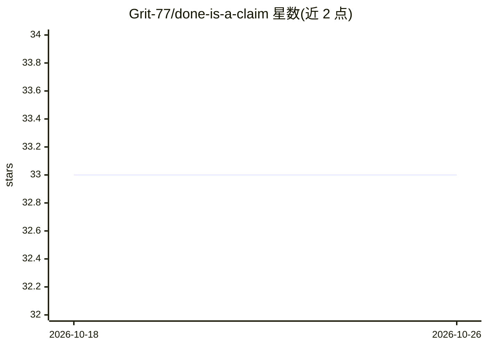

# Grit-77/done-is-a-claim

⭐ 33 · Python · Apache-2.0 · 推送 2026-10-25 · [GitHub](https://github.com/Grit-77/done-is-a-claim) · [官网](https://github.com/Grit-77/done-is-a-claim#get-started) · 组织维护 · 中文 README

**给编码智能体的“证据优先”工作流与技能插件包**

面向 Claude Code 与 Codex 编码智能体的证据优先开发工作流：提供 15 个相互衔接的 SKILL.md 技能（规划、测试实现、诊断、评审、交付核验等）、18 条来自事故记录的规则（AGENTS.md），以及可选的本地工具——receipt.py 捕获命令退出码与输出生成回执、check_receipt.py 复核回执新鲜度。安装后由智能体在工作流中调用，需 Python 3.10+ 运行示例与工具。规则源自作者在自有仓库运行智能体的内部记录，作者声明这些数字非公开基准。

## 筛选速览

| 维度 | 判定 | 备注 |
|---|---|---|
| AI 角色 | `ai-ecosystem` | LLM/agent 周边工具 |
| 许可风险 | `permissive` | Apache-2.0 |
| 部署形态 | `None` |  |
| 模型依赖 | — | README 未给出锁定关系 |
| 硬件要求 | — | 无带数字的原话,不猜 |
| 安装摩擦 | `low` | 无编译、无系统依赖或容器化 |
| 成熟度 | — | 结构信号不足 |

## 能力要点

- 15 个技能覆盖理解→计划→实现→诊断→评审→验证→交付流程
- receipt.py 捕获命令退出码、完整输出与 Git 状态生成证据回执
- 18 条规则，每条附 INCIDENTS.md 中的失败案例
- 提供 Claude Code 与 Codex 原生插件安装及 AGENTS.md 项目级复制两种方式

## 适用场景

- 让编码智能体在声称“完成”前附上可核验的测试证据
- 复审或交接时复核旧回执对当前代码是否仍然有效
- 审查智能体交付的构件是否与评审过的版本一致

## 场景标签

`编码 Agent` `代码审查` · 领域:编码与开发

## 证据(README 行号)

> L11: An evidence-first development workflow for coding agents: **understand → plan →
> L226: Each skill is a standalone `SKILL.md`. No Grit service, account or CLI is needed.
> L243: These rules grew out of running Claude Code and Codex on Grit's own repository.

## 星数曲线

2026-10-18 33 → 2026-10-26 33（+0）

---
*卡片 v1 · prompt 1.4 · 生成 2026-10-26 · 置信度 high · 依据 README sha `1586a3c02e53` · [字段定义](../../DATASET.md)*
