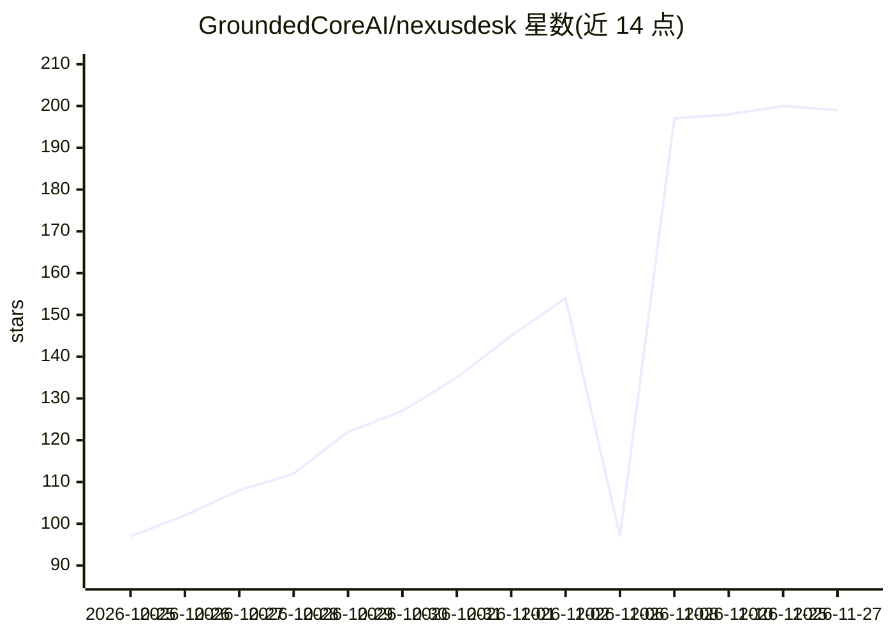

# GroundedCoreAI/nexusdesk

⭐ 199 · Python · Apache-2.0 · 推送 2026-11-26 · [GitHub](https://github.com/GroundedCoreAI/nexusdesk) · [官网](https://groundedcoreai.github.io/nexusdesk/) · 组织维护 · 中文 README

**企业自托管 AI 员工运营平台，首个应用为 AI 客服**

NexusDesk 是开源、可自托管的企业 AI 运营平台，以"AI 员工"为执行单元，围绕 ReAct Agent 与 Harness 工程构建：LangGraph ReAct 循环负责推理与工具调用，Harness 提供任务管理、权限约束、人机协作与执行审计等工程边界。首个完整参考应用是 AI 客服，覆盖知识检索、业务工具、会话接管与工单。默认部署只需 PostgreSQL，Milvus/MinIO/S3 按功能启用；提供 Docker 快速启动与生产部署两条路径，含四个示例应用与九套行业案例集。

## 筛选速览

| 维度 | 判定 | 备注 |
|---|---|---|
| AI 角色 | `ai-ecosystem` | LLM/agent 周边工具 |
| 许可风险 | `permissive` | Apache-2.0 |
| 部署形态 | `self-host` | docker 或自建部署 |
| 模型依赖 | — | README 未给出锁定关系 |
| 硬件要求 | — | 无带数字的原话,不猜 |
| 安装摩擦 | `low` | 无编译、无系统依赖或容器化 |
| 成熟度 | — | 结构信号不足 |

## 能力要点

- ReAct Agent + Harness 工程：动态推理与确定性控制结合
- 模型网关统一管理 Chat/Embedding/Rerank/OCR/语音模型连接
- 人机协作与会话接管、执行记录与审计
- Quickstart 预置 9 知识库、18 Agent 草稿、36 文档的案例集

## 适用场景

- 自托管企业 AI 客服：知识问答、工单与人协作
- 在权限与审计边界内运行执行业务任务的 Agent
- 通过渠道接口把 Agent 接入企业已有消息平台

## 场景标签

`Agent 框架` `模型网关` `RAG` · 领域:Agent 开发

## 证据(README 行号)

> L9: **NexusDesk is an open-source, self-hostable, and extensible enterprise AI operations platform.**
> L28: NexusDesk is built around **ReAct Agent and Harness Engineering**:
> L145: |Agent configuration and execution|Configure, publish, and roll back agents; run reasoning and tool calls through 

## 星数曲线

2026-10-25 97 → 2026-11-27 199（+102）

---
*卡片 v1 · prompt 1.4 · 生成 2026-11-25 · 置信度 high · 依据 README sha `530eef89a5f8` · [字段定义](../../DATASET.md)*
