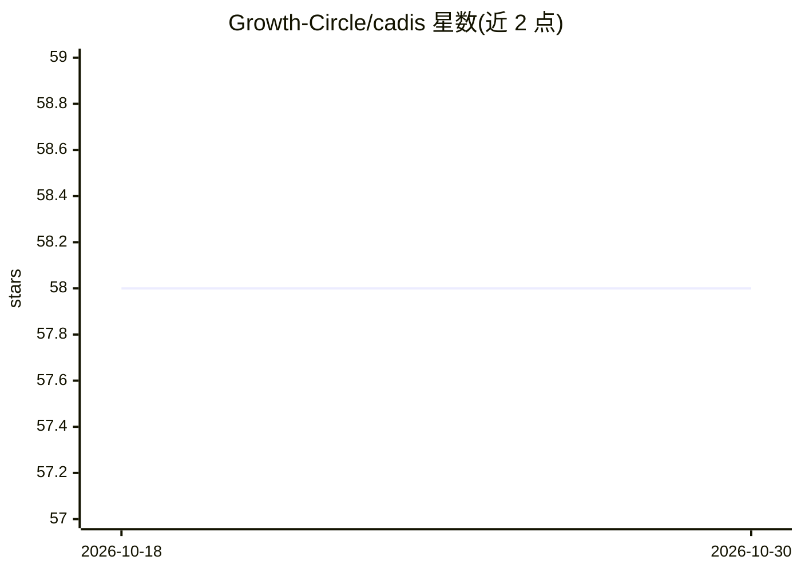

# Growth-Circle/cadis

⭐ 58 · Rust · NOASSERTION · 推送 2026-08-19 · [GitHub](https://github.com/Growth-Circle/cadis) · [官网](https://github.com/Growth-Circle/cadis#readme) · 组织维护

**本地优先多 agent 运行时：守护进程编排 agent、工具策略与审批**

Rust 编写的本地优先多 agent 运行时：单一守护进程 cadisd 统一管理 agent 编排、工具策略与审批状态，CLI、桌面 HUD（Tauri+React）、语音界面等均为协议客户端。功能含多 agent 协调与 git worktree 隔离的代码 worker、带审批门控的原生工具（文件/git/shell）、风险分级与审计记录、模型无关路由（Ollama/OpenAI/Codex CLI 适配器）、Whisper 语音输入与 Edge TTS 输出。通过 npm、二进制发布或源码（Rust 1.75+）安装，支持 Linux/macOS/Windows。状态为 Beta。

## 筛选速览

| 维度 | 判定 | 备注 |
|---|---|---|
| AI 角色 | `ai-ecosystem` | LLM/agent 周边工具 |
| 许可风险 | `permissive` | NOASSERTION |
| 部署形态 | `desktop` | 安装包/桌面程序 |
| 模型依赖 | local-ok | 支持本地模型 |
| 硬件要求 | — | 无带数字的原话,不猜 |
| 安装摩擦 | `medium` | 含编译或系统依赖之一 |
| 成熟度 | `idea` | |

## 能力要点

- 单守护进程 cadisd 统一管理 agent、工具策略与审批状态
- 审批门控的原生工具：风险分类、审计记录、过期检查
- 模型无关适配器：Ollama、OpenAI API、Codex CLI，原生流式输出
- git worktree 隔离的代码 worker 与语音 I/O

## 适用场景

- 在本地编排多个 agent 执行隔离的编码工作流
- 对 agent 的文件/shell/git 操作做审批与审计管控
- 通过桌面 HUD 或语音界面控制 agent 与模型路由

## 场景标签

`多智能体` `编码 Agent` · 领域:Agent 开发

## 证据(README 行号)

> L30: C.A.D.I.S. is a **Rust-first, local-first, model-agnostic** runtime where one
> L31: daemon (`cadisd`) owns all agent orchestration, tool policy, and approval state.
> L100: - **Model-agnostic** — Ollama, OpenAI API, and Codex CLI adapters with native streaming

## 星数曲线

2026-10-18 58 → 2026-10-30 58（+0）

---
*卡片 v1 · prompt 1.4 · 生成 2026-10-24 · 置信度 high · 依据 README sha `cf2df3533b65` · [字段定义](../../DATASET.md)*
