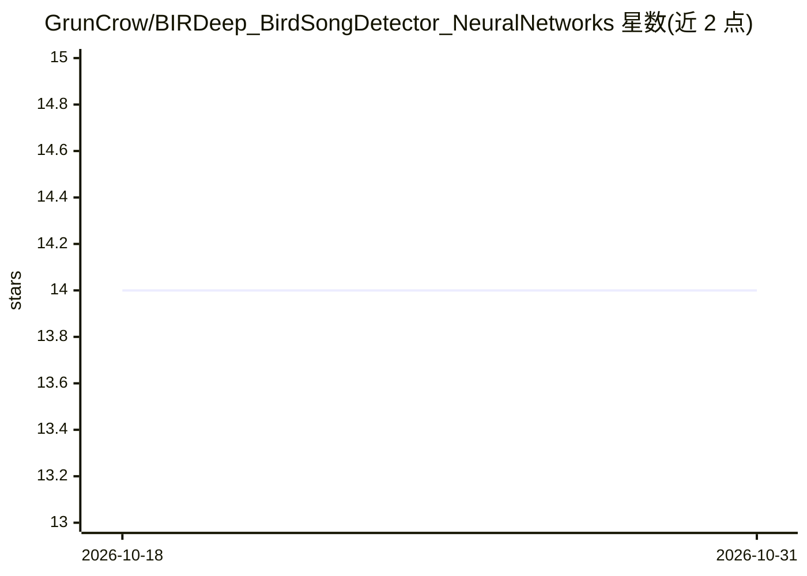

# GrunCrow/BIRDeep_BirdSongDetector_NeuralNetworks

⭐ 14 · Jupyter Notebook · MIT · 推送 2026-06-22 · [GitHub](https://github.com/GrunCrow/BIRDeep_BirdSongDetector_NeuralNetworks) · 组织维护

**多尼亚纳公园鸟鸣检测与物种分类深度学习研究代码库**

BIRDeep 项目的研究代码仓库：提供基于 YOLOv8 的鸟鸣检测器（在频谱图上检测鸟类发声片段）与微调版 BirdNET 分类器（含嵌入特征训练的神经网络、随机森林、ResNet50、MobileNetV2）组成两阶段流水线，用于自动被动声学监测数据中的鸟类物种识别。数据来自多尼亚纳国家公园 AudioMoth 录音（约500分钟，专家标注461分钟），数据集发布于 Hugging Face。论文指出数据量不足以生成稳健检测模型，检测 mAP50 约 0.30，加检测步骤后各分类器指标均有提升。通过 git clone 加 conda 环境复现，另有轻量版 Bird-Song-Detector 仓库供快速测试。

## 筛选速览

| 维度 | 判定 | 备注 |
|---|---|---|
| AI 角色 | `ai-native` | 本体是模型或模型工具 |
| 许可风险 | `permissive` | MIT |
| 部署形态 | `None` |  |
| 模型依赖 | — | README 未给出锁定关系 |
| 硬件要求 | — | 无带数字的原话,不猜 |
| 安装摩擦 | `low` | 无编译、无系统依赖或容器化 |
| 成熟度 | — | 结构信号不足 |

## 能力要点

- YOLOv8 检测器 + 微调 BirdNET 分类器的两阶段流水线
- 提取 1024 维嵌入训练多种分类器（NN/随机森林/ResNet50/MobileNetV2）
- 数据集 BIRDeep_AudioAnnotations 公开于 Hugging Face
- 附论文（Ecological Informatics 2025）与轻量版检测器仓库

## 适用场景

- 复现被动声学监测的鸟鸣检测与物种分类研究
- 在区域声景数据上做鸟类物种识别流水线
- 获取多尼亚纳公园标注音频数据集与训练脚本

## 场景标签

 · 领域:生态学/生物声学

## 证据(README 行号)

> L17: In the paper *A Bird Song Detector for improving bird identification through Deep Learning: a case study from Doñan
> L25: 2. **Bird Song Detector**: A YOLOv8-based model was trained to detect segments containing bird vocalizations (prese
> L27: 3. **Classifier**: BirdNET was fine-tuned on expert-labeled data from Doñana. Its embeddings were used to train add

## 星数曲线

2026-10-18 14 → 2026-10-31 14（+0）

---
*卡片 v1 · prompt 1.4 · 生成 2026-10-31 · 置信度 high · 依据 README sha `91e4c3717b40` · [字段定义](../../DATASET.md)*
