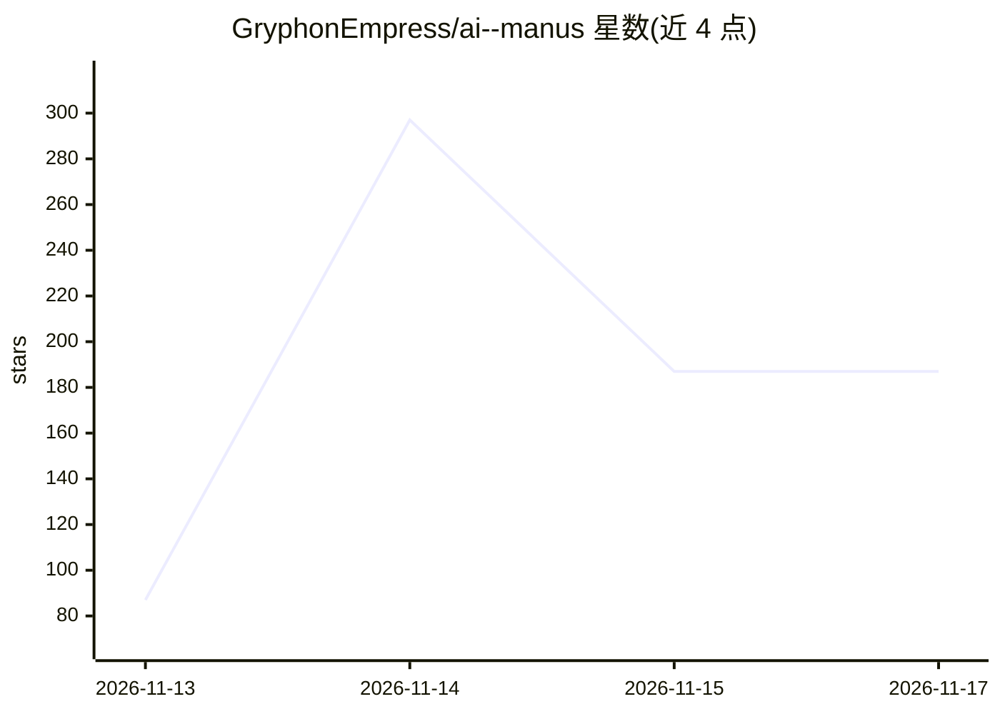

# GryphonEmpress/ai--manus

⭐ 187 · Apache-2.0 · 推送 2026-11-15 · [GitHub](https://github.com/GryphonEmpress/ai--manus) · 个人维护

**自主执行代码与控制浏览器的通用 AI Agent 系统**

README 描述一个面向家庭、学习与轻办公场景的自主 AI Agent：用户以自然语言下达指令，Agent 自行编写并执行脚本、打开网页、填写表单、跨代码与浏览器完成多步任务，无需深度编程背景。文档还声明其在会话间保持任务模式一致，可后台常驻等待调用。README 为功能介绍与兼容性/上手说明，未包含代码仓库结构、安装命令或 API 接入细节；描述中提及沙箱环境运行工具与操作（来自仓库描述）。兼容性表列出最低双核 CPU 与 4GB 内存要求。

## 筛选速览

| 维度 | 判定 | 备注 |
|---|---|---|
| AI 角色 | `ai-native` | 本体是模型或模型工具 |
| 许可风险 | `permissive` | Apache-2.0 |
| 部署形态 | `None` |  |
| 模型依赖 | — | README 未给出锁定关系 |
| 硬件要求 | — | 无带数字的原话,不猜 |
| 安装摩擦 | `low` | 无编译、无系统依赖或容器化 |
| 成熟度 | — | 结构信号不足 |

## 能力要点

- 自主编写并执行代码完成多步任务
- 浏览器控制：导航网页、填写表单、采集信息
- 代码执行与浏览器操作在同一工作流中衔接
- 面向非开发者的低门槛个人助理定位

## 适用场景

- 让学生整理研究资料、跑小型脚本
- 远程工作者从多个网页收集数据并汇总
- 把重复性的小任务委托给后台 Agent 处理
- 快速运行小实验而无需搭建完整开发环境

## 场景标签

`AI 助手` `编码 Agent` `浏览器自动化` · 领域:效率与自动化

## 证据(README 行号)

> L18: Manus is an autonomous AI agent designed to run code and control a browser on your behalf. Instead of acting like a
> L10: - **Autonomous Code Execution:** Manus AI agent runs code on its own to complete tasks, so you can focus on decisio

## 星数曲线

2026-11-13 87 → 2026-11-17 187（+100）

---
*卡片 v1 · prompt 1.4 · 生成 2026-11-17 · 置信度 mid · 依据 README sha `a3d88e202bf0` · [字段定义](../../DATASET.md)*
