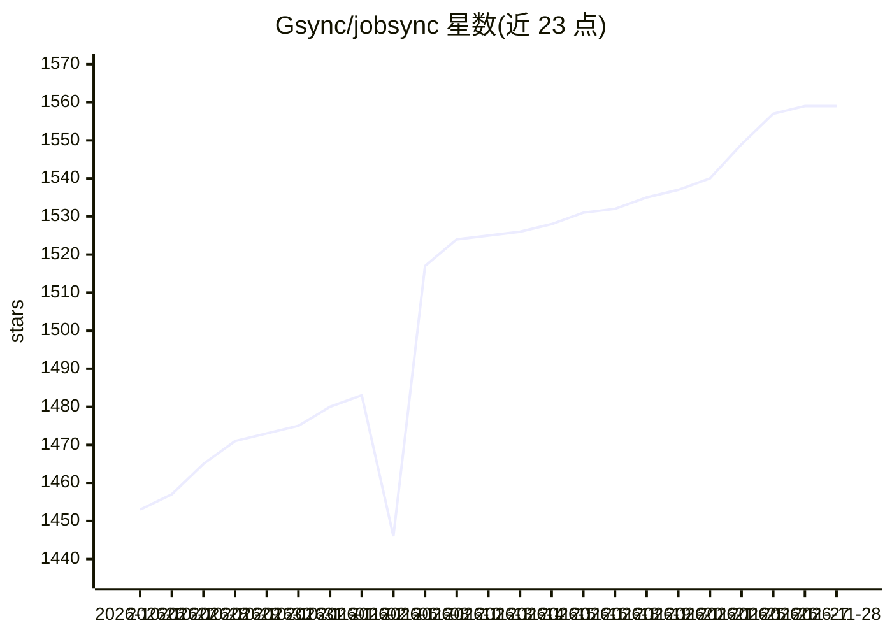

# Gsync/jobsync

⭐ 1,559 · TypeScript · MIT · 推送 2026-11-27 · [GitHub](https://github.com/Gsync/jobsync) · [官网](https://jobsync.ca) · 个人维护

**自托管的求职申请追踪器，附 AI 简历评审与职位匹配**

面向求职者的自托管应用：追踪投递记录、面试、联系人、任务与公司信息，支持 PDF 简历导出与导入；AI 部分提供简历评审、职位匹配评分、求职信生成、从粘贴的职位描述中提取结构化信息，以及定时抓取 Greenhouse/Lever/Ashby 职位板并按简历做匹配排名。模型可通过 Ollama 本地运行或接入云服务商 API，密钥保存在设置中并可加密；通过 Docker Compose 部署，内置 Postgres，暴露 MCP server 供 Claude Desktop 等 agent 客户端写入数据。

## 筛选速览

| 维度 | 判定 | 备注 |
|---|---|---|
| AI 角色 | `ai-enhanced` | 去掉 AI 部分产品仍成立 |
| 许可风险 | `permissive` | MIT |
| 部署形态 | `self-host` | docker 或自建部署 |
| 模型依赖 | local-ok | 支持本地模型 |
| 硬件要求 | — | 无带数字的原话,不猜 |
| 安装摩擦 | `low` | 无编译、无系统依赖或容器化 |
| 成熟度 | — | 结构信号不足 |

## 能力要点

- AI 助手聊天面板：简历评审、职位匹配评分、求职信生成
- 定时自动化抓取 Greenhouse/Lever/Ashby 职位板并做 AI 匹配
- MCP server 支持 Claude Desktop、Hermes、OpenClaw 等 agent 客户端添加职位与题库条目
- AI 调用按 provider/model/feature 统计 tokens、响应时间与失败

## 适用场景

- 集中管理求职投递、面试轮次与联系人记录
- 让 AI 评审简历并给职位打匹配分、生成求职信
- 定时监控目标公司职位板，自动发现新岗位
- 通过 Claude Desktop 等 agent 语音/对话式录入职位信息

## 场景标签

`AI 助手` · 领域:对话与助手

## 证据(README 行号)

> L16: Track every application, get AI resume reviews and job matches, and discover new openings automatically — **free, o
> L35: - **Application Tracker:** Record every application with its company, title, dates and current status.
> L49: - **AI Assistant:** A docked chat that reviews resumes, scores job matches, writes cover letters and adds jobs you 

## 星数曲线

2026-10-26 1,453 → 2026-11-28 1,559（+106）

---
*卡片 v1 · prompt 1.4 · 生成 2026-11-23 · 置信度 high · 依据 README sha `cdb94ed9ae92` · [字段定义](../../DATASET.md)*
