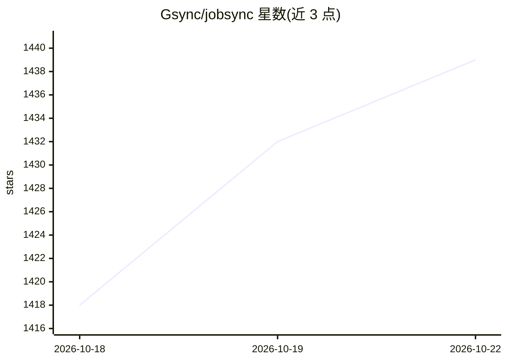

# Gsync/jobsync

⭐ 1,439 · TypeScript · MIT · 推送 2026-10-19 · [GitHub](https://github.com/Gsync/jobsync) · [官网](https://jobsync.ca) · 个人维护

**自托管求职助手：AI 简历评审、岗位匹配与投递追踪**

面向求职者的自托管 Web 应用：集中管理投递记录、简历、联系人、面试题目与任务，并通过 AI 助手完成简历评审打分、简历-岗位匹配、求职信撰写、从粘贴的招聘信息中抽取建岗。支持定时从 Greenhouse/Lever/Ashby 公司招聘板自动发现新岗位并用 AI 匹配简历。可用 Ollama 本地运行模型，或配置云厂商 API key；另暴露 MCP server 供 Claude Desktop 等 agent 直接录入岗位与题目。通过 Docker Compose 部署，数据留在用户服务器。AI 模型需支持结构化输出与工具调用。

## 筛选速览

| 维度 | 判定 | 备注 |
|---|---|---|
| AI 角色 | `ai-enhanced` | 去掉 AI 部分产品仍成立 |
| 许可风险 | `permissive` | MIT |
| 部署形态 | `self-host` | docker 或自建部署 |
| 模型依赖 | local-ok | 支持本地模型 |
| 硬件要求 | — | 无带数字的原话,不猜 |
| 安装摩擦 | `low` | 无编译、无系统依赖或容器化 |
| 成熟度 | — | 结构信号不足 |

## 能力要点

- AI 简历评审、岗位匹配评分与求职信生成，结果保存回简历/岗位
- Greenhouse/Lever/Ashby 定时自动发现岗位并用 AI 匹配简历
- Ollama 本地模型默认支持，或配置云厂商 API key
- MCP server 供 Claude Desktop 等 agent 直接添加岗位与面试题

## 适用场景

- 在一处集中管理我的全部求职投递、简历与联系人
- 用 AI 审简历、评估岗位匹配度并生成求职信
- 定时自动发现目标公司新岗位并按简历相关度排序

## 场景标签

`AI 助手` `网页抓取` · 领域:效率与自动化

## 证据(README 行号)

> L16: Track every application, get AI resume reviews and job matches, and discover new openings automatically — **free, o
> L47: - **AI Assistant:** A docked chat that reviews resumes, scores job matches, writes cover letters and adds jobs you 

## 星数曲线

2026-10-18 1,418 → 2026-10-22 1,439（+21）

---
*卡片 v1 · prompt 1.4 · 生成 2026-10-21 · 置信度 high · 依据 README sha `ea5ff496a278` · [字段定义](../../DATASET.md)*
