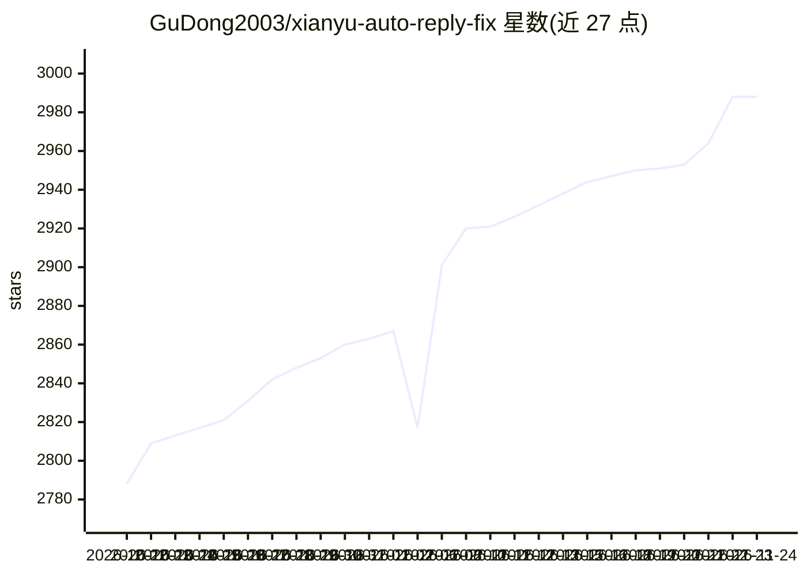

# GuDong2003/xianyu-auto-reply-fix

⭐ 2,991 · Python · AGPL-3.0 · 推送 2026-11-12 · [GitHub](https://github.com/GuDong2003/xianyu-auto-reply-fix) · 个人维护 · 中文 README

**闲鱼卖家的多账号客服系统：AI 自动回复与自动发货**

基于 FastAPI + SQLite + Playwright 的闲鱼管理系统，提供多用户注册与权限隔离、多账号 Cookie 维护、关键词/默认/指定商品/AI 自动回复、文本与图片等多种自动发货方式、商品信息收集与订单管理，并附 Web 管理后台、实时日志与健康检查。AI 回复通过统一的 model_name/api_key/base_url 配置接入多种 LLM 接口。采用 AGPL-3.0，定位学习研究使用，支持 Docker Compose 与本地运行。

## 筛选速览

| 维度 | 判定 | 备注 |
|---|---|---|
| AI 角色 | `ai-enhanced` | 去掉 AI 部分产品仍成立 |
| 许可风险 | `viral` | AGPL-3.0 |
| 部署形态 | `self-host` | docker 或自建部署 |
| 模型依赖 | locked-api |  |
| 硬件要求 | — | 无带数字的原话,不猜 |
| 安装摩擦 | `low` | 无编译、无系统依赖或容器化 |
| 成熟度 | — | 结构信号不足 |

## 能力要点

- 多用户多账号管理，独立启停与 Cookie 维护
- 关键词、默认、指定商品、图片关键词与 AI 自动回复
- 文本、批量数据、API、图片等自动发货方式与防重复处理
- Docker Compose 一键部署与实时日志、健康检查

## 适用场景

- 为多个闲鱼账号配置统一的自动回复规则
- 设置商品自动发货与防重复处理
- 通过 Web 后台集中查看订单、日志与消息通知

## 场景标签

`浏览器自动化` `聊天机器人` · 领域:效率与自动化

## 证据(README 行号)

> L13: 一个基于 **FastAPI + SQLite + Playwright** 的闲鱼管理系统，支持多用户、多账号管理、关键词回复、AI 自动回复、自动发货、商品管理、日志监控和 Docker 一键部署。
> L38: - **智能回复**：支持关键词回复、默认回复、指定商品回复、图片关键词和 AI 自动回复。
> L99: AI 回复使用统一的 `model_name` / `api_key` / `base_url` / `api_type` 配置模式，支持 OpenAI-compatible、OpenAI Responses、DashScope、

## 星数曲线

2026-10-22 2,788 → 2026-11-24 2,988（+200）

---
*卡片 v1 · prompt 1.4 · 生成 2026-11-23 · 置信度 high · 依据 README sha `3b054de85862` · [字段定义](../../DATASET.md)*
