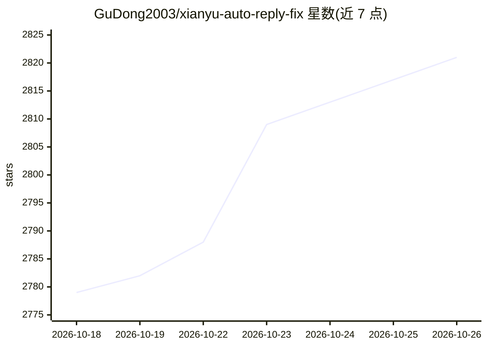

# GuDong2003/xianyu-auto-reply-fix

⭐ 2,821 · Python · AGPL-3.0 · 推送 2026-10-24 · [GitHub](https://github.com/GuDong2003/xianyu-auto-reply-fix) · 个人维护 · 中文 README

**闲鱼卖家的自托管客服管理系统：多账号、AI 自动回复、自动发货**

基于 FastAPI + SQLite + Playwright 的闲鱼账号管理系统，提供多用户注册登录与数据隔离、多账号 Cookie 维护、关键词/默认/AI 自动回复、文本与 API 等多方式自动发货、商品信息收集与订单管理，并带实时日志、健康检查的 Web 管理后台。AI 回复通过统一的 model_name/api_key/base_url 配置接入 OpenAI-compatible、DashScope、Gemini、Anthropic、Azure 等接口。支持 Docker Compose 一键部署与本地运行。AGPL-3.0 协议，定位学习研究用途。

## 筛选速览

| 维度 | 判定 | 备注 |
|---|---|---|
| AI 角色 | `ai-enhanced` | 去掉 AI 部分产品仍成立 |
| 许可风险 | `viral` | AGPL-3.0 |
| 部署形态 | `self-host` | docker 或自建部署 |
| 模型依赖 | locked-api |  |
| 硬件要求 | — | 无带数字的原话,不猜 |
| 安装摩擦 | `low` | 无编译、无系统依赖或容器化 |
| 成熟度 | — | 结构信号不足 |

## 能力要点

- 多用户多账号管理，独立启停与 Cookie 维护
- 关键词回复与 AI 自动回复（多种 LLM Provider 接入）
- 文本/批量数据/API/图片多方式自动发货并防重复
- Docker Compose 一键部署，Web 后台含日志监控与健康检查

## 适用场景

- 我管理多个闲鱼账号，希望集中处理消息与订单
- 我想让 AI 自动回复买家咨询并自动发货
- 我需要一个带权限控制和数据隔离的自托管客服后台

## 场景标签

`聊天机器人` `工作流自动化` · 领域:效率与自动化

## 证据(README 行号)

> L13: 一个基于 **FastAPI + SQLite + Playwright** 的闲鱼管理系统，支持多用户、多账号管理、关键词回复、AI 自动回复、自动发货、商品管理、日志监控和 Docker 一键部署。
> L21: - **智能回复**：支持关键词回复、默认回复、指定商品回复、图片关键词和 AI 自动回复。
> L82: AI 回复使用统一的 `model_name` / `api_key` / `base_url` / `api_type` 配置模式，支持 OpenAI-compatible、OpenAI Responses、DashScope、

## 星数曲线

2026-10-18 2,779 → 2026-10-26 2,821（+42）

---
*卡片 v1 · prompt 1.4 · 生成 2026-10-21 · 置信度 high · 依据 README sha `acfbaf501889` · [字段定义](../../DATASET.md)*
