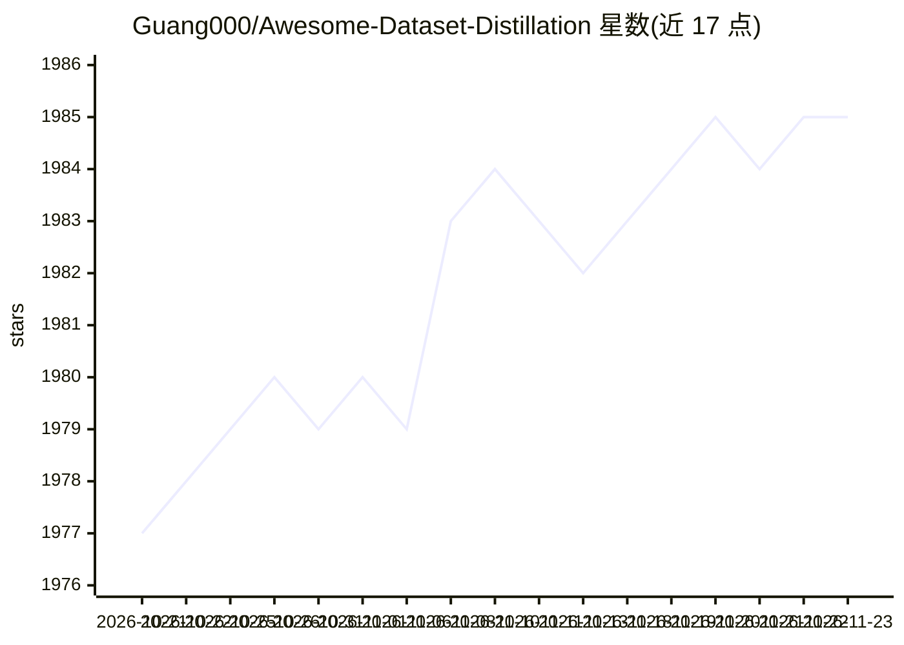

# Guang000/Awesome-Dataset-Distillation

⭐ 1,985 · HTML · MIT · 推送 2026-11-19 · [GitHub](https://github.com/Guang000/Awesome-Dataset-Distillation) · [官网](https://guang000.github.io/Awesome-Dataset-Distillation/) · 个人维护

**数据集蒸馏领域论文策展清单（awesome-list）**

围绕 dataset distillation（将大数据集合成为小型合成数据集）任务的论文聚合清单，按代理目标（梯度/轨迹匹配、分布/特征匹配）、核方法、参数化方式、生成式蒸馏（GAN/Diffusion）等类别组织条目，每条附项目页、代码与 bibtex 链接，持续更新收录 NeurIPS/CVPR/ICLR 等会议论文，面向需要检索该领域文献的研究者，由 Guang Li、Bo Zhao、Tongzhou Wang 维护。

## 筛选速览

| 维度 | 判定 | 备注 |
|---|---|---|
| AI 角色 | `ai-knowledge` | 知识聚合/清单类 |
| 许可风险 | `permissive` | MIT |
| 部署形态 | `None` |  |
| 模型依赖 | — | README 未给出锁定关系 |
| 硬件要求 | — | 无带数字的原话,不猜 |
| 安装摩擦 | `low` | 无编译、无系统依赖或容器化 |
| 成熟度 | — | 结构信号不足 |

## 能力要点

- 按代理目标、核方法、参数化、生成式蒸馏等类别组织论文条目
- 每条论文附项目页、代码仓库与 bibtex 引用链接
- 含 Latest Updates 区块持续收录新会议论文

## 适用场景

- 入门数据集蒸馏方向时快速了解任务定义与代表性方法
- 写综述或相关工作时按类别查找论文与引用格式
- 寻找某个蒸馏方法的官方代码实现

## 场景标签

`精选清单` `科研工具` · 领域:学习与行业

## 证据(README 行号)

> L6: **Awesome Dataset Distillation** provides the most comprehensive and detailed information on the Dataset Distillatio
> L29: ## Contents
> L31: ## Main

## 星数曲线

2026-10-21 1,977 → 2026-11-23 1,985（+8）

---
*卡片 v1 · prompt 1.4 · 生成 2026-11-23 · 置信度 high · 依据 README sha `350e1b8b03ff` · [字段定义](../../DATASET.md)*
