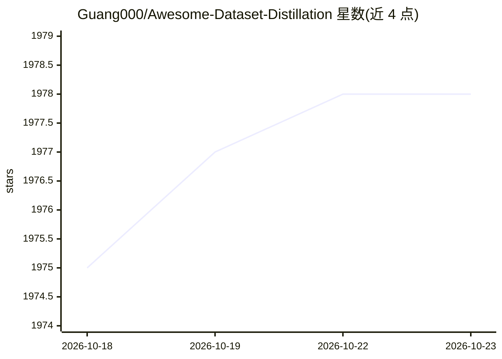

# Guang000/Awesome-Dataset-Distillation

⭐ 1,978 · HTML · MIT · 推送 2026-10-21 · [GitHub](https://github.com/Guang000/Awesome-Dataset-Distillation) · [官网](https://guang000.github.io/Awesome-Dataset-Distillation/) · 组织维护

**数据集蒸馏领域论文策展清单，按方法类别组织**

数据集蒸馏领域的论文聚合清单，由 Guang Li、Bo Zhao、Tongzhou Wang 维护。领域任务定义：从大规模真实数据集合 成小型合成数据集，使在其上训练的模型在原数据集上保持性能。清单按梯度/轨迹匹配、分布/特征匹配、核方法、参数化、生成式蒸馏等方法类别组织条目，每条含作者、发表会议与项目页/代码/bibtex 链接，并设 Latest Updates 板块跟踪新论文，接受 PR 提交。

## 筛选速览

| 维度 | 判定 | 备注 |
|---|---|---|
| AI 角色 | `ai-knowledge` | 知识聚合/清单类 |
| 许可风险 | `permissive` | MIT |
| 部署形态 | `None` |  |
| 模型依赖 | — | README 未给出锁定关系 |
| 硬件要求 | — | 无带数字的原话,不猜 |
| 安装摩擦 | `low` | 无编译、无系统依赖或容器化 |
| 成熟度 | — | 结构信号不足 |

## 能力要点

- 按 5+ 个方法类别（梯度匹配、分布匹配、核方法、参数化、生成式等）组织论文条目
- 每条目提供作者、会议、项目页/代码/bibtex 链接
- 设 Latest Updates 板块跟踪近期论文
- 通过 pull request 接受社区投稿

## 适用场景

- 查找数据集蒸馏领域的论文与开源代码
- 按方法类别梳理领域研究脉络
- 跟踪该方向最新发表的工作

## 场景标签

`精选清单` · 领域:学习与行业

## 证据(README 行号)

> L6: **Awesome Dataset Distillation** provides the most comprehensive and detailed information on the Dataset Distillatio
> L8: **Dataset distillation** is the task of synthesizing a small dataset such that models trained on it achieve high per
> L12: **This project is curated and maintained by Guang Li, Bo Zhao, and Tongzhou Wang.**

## 星数曲线

2026-10-18 1,975 → 2026-10-23 1,978（+3）

---
*卡片 v1 · prompt 1.4 · 生成 2026-10-21 · 置信度 high · 依据 README sha `702fa4307661` · [字段定义](../../DATASET.md)*
