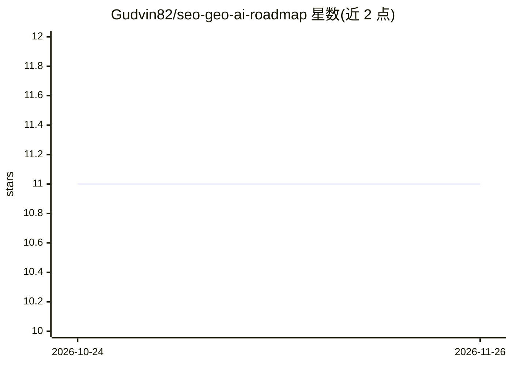

# Gudvin82/seo-geo-ai-roadmap

⭐ 11 · Python · MIT · 推送 2026-09-26 · [GitHub](https://github.com/Gudvin82/seo-geo-ai-roadmap) · [官网](https://anmalishev.ru/) · 个人维护

**自托管 SEO/GEO/AI 可见性平台：审计与交付方法论加 FastAPI 应用**

面向 SEO/GEO 工作流的免费自托管系统，由三层组成：方法论框架（playbook、prompt、清单、模板）、自托管 FastAPI 应用（认证、工作区、项目、审计、报告、扫描流程、导出）以及可复用的服务流程。提供 AI-agent 任务包，可将仓库交给 Cursor、Claude Code 等编码代理执行站点审计；v6.15 引入带凭据门控的 DataForSEO 付费数据流与只读 MCP 接口，GEO 分数定位为可解释的优先级信号而非排名预测。

## 筛选速览

| 维度 | 判定 | 备注 |
|---|---|---|
| AI 角色 | `ai-enhanced` | 去掉 AI 部分产品仍成立 |
| 许可风险 | `permissive` | MIT |
| 部署形态 | `None` |  |
| 模型依赖 | — | README 未给出锁定关系 |
| 硬件要求 | — | 无带数字的原话,不猜 |
| 安装摩擦 | `low` | 无编译、无系统依赖或容器化 |
| 成熟度 | `idea` | |

## 能力要点

- FastAPI 自托管应用：认证、工作区、审计、报告、扫描与导出
- AI-agent 任务包，支持交给 Cursor/Claude Code/Codex 执行审计
- 凭据门控的 DataForSEO 付费数据流（关键词、SERP、竞品、外链）
- 项目级只读 MCP 接口，访问报告、任务、证据与 AI 可见性历史

## 适用场景

- 代理公司为客户做周期性 SEO/GEO 审计与交付
- 企业内部 SEO 与 AI 可见性团队部署自有审计平台
-  founders 为自己站点搭建可发现性系统
- AI 编码代理按仓库路径执行 site-audit 任务

## 场景标签

`数据分析` · 领域:效率与自动化

## 证据(README 行号)

> L18: Free, transparent, self-hosted platform for SEO, GEO, and AI discoverability.
> L37:  Self-hosted FastAPI app with auth, workspaces, projects, audits, reports,
> L111:  Give the repo to Cursor, Claude Code, Codex, VS Code, or a similar agent.

## 星数曲线

2026-10-24 11 → 2026-11-26 11（+0）

---
*卡片 v1 · prompt 1.4 · 生成 2026-11-19 · 置信度 mid · 依据 README sha `04a005c744fe` · [字段定义](../../DATASET.md)*
