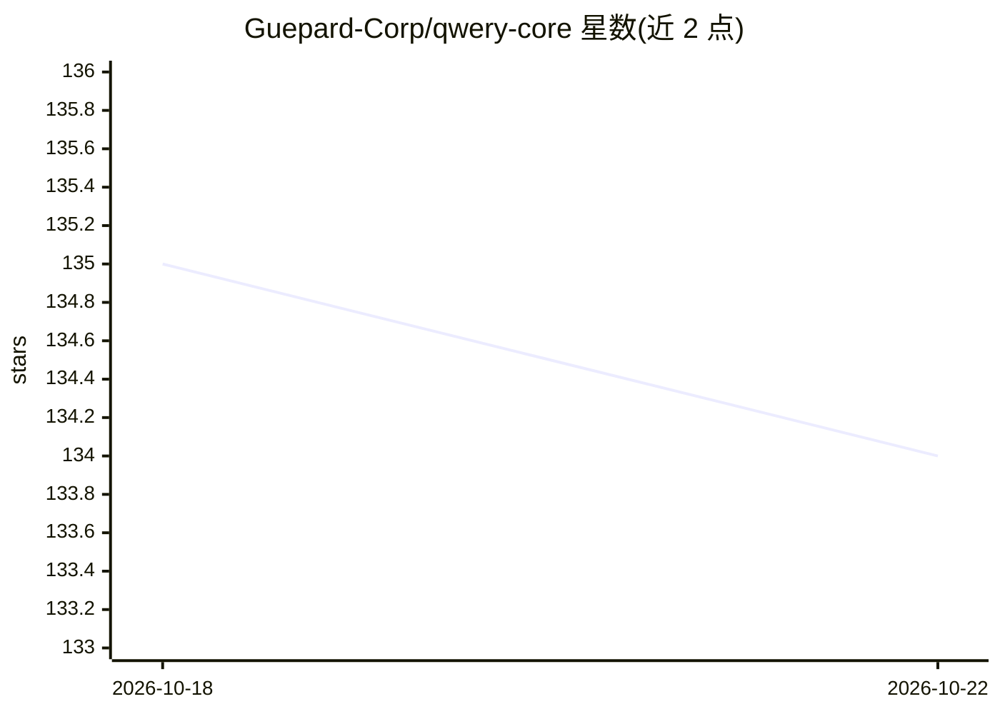

# Guepard-Corp/qwery-core

⭐ 134 · TypeScript · MIT · 推送 2026-08-01 · [GitHub](https://github.com/Guepard-Corp/qwery-core) · [官网](https://agent.qwery.run) · 组织维护

**终端里的 AI 数据分析师：自然语言查询多种数据源**

Qwery 是一个运行在终端的 AI 数据代理，用户用自然语言提问，它连接数据源（PostgreSQL、MySQL、ClickHouse、DuckDB、CSV、Parquet、S3 等）、自动生成 SQL 并在本地查询引擎执行后作答。包含 DataAgent（分析）与 CodingAgent（构建脚本/应用）两个代理。隐私设计上，行级数据不离开本机、不发送给 LLM，模型只看到 schema 与聚合标量；破坏性操作前可用 GFS 对数据库做分支与快照。模型可自选（Ollama 本地、Azure OpenAI、AWS Bedrock、任意 OpenAI 兼容端点）。README 声明项目仍在活跃开发、不适合生产使用。

## 筛选速览

| 维度 | 判定 | 备注 |
|---|---|---|
| AI 角色 | `ai-native` | 本体是模型或模型工具 |
| 许可风险 | `permissive` | MIT |
| 部署形态 | `None` |  |
| 模型依赖 | local-ok | 支持本地模型 |
| 硬件要求 | — | 无带数字的原话,不猜 |
| 安装摩擦 | `low` | 无编译、无系统依赖或容器化 |
| 成熟度 | `idea` | |

## 能力要点

- 自然语言提问自动生成 SQL 并在本地执行
- 行级数据不离开本机，LLM 仅见 schema 与聚合标量
- GFS 对数据库做分支/快照/时间回溯保护破坏性操作
- 通过扩展接入 PostgreSQL、ClickHouse、DuckDB、S3、Google Sheets 等多种数据源

## 适用场景

- 不写 SQL，用自然语言直接查询自己的数据库和文件
- 在数据分析之外让 CodingAgent 顺手搭脚本和小应用
- 用本地 Ollama 模型做离线数据分析

## 场景标签

`数据分析` `编码 Agent` · 领域:效率与自动化

## 证据(README 行号)

> L30: Qwery is an AI data analyst that lives in your terminal. Ask questions in plain language; Qwery connects to your da
> L32: It pairs two agents (a **DataAgent** for analysis and a **CodingAgent** for building scripts and apps) behind a sin
> L45: - **Bring your own model**: configure any provider in-app via `/models` (Ollama local & cloud, Azure OpenAI, AWS Be

## 星数曲线

2026-10-18 135 → 2026-10-22 134（-1）

---
*卡片 v1 · prompt 1.4 · 生成 2026-10-22 · 置信度 high · 依据 README sha `9dd24ff3cd19` · [字段定义](../../DATASET.md)*
