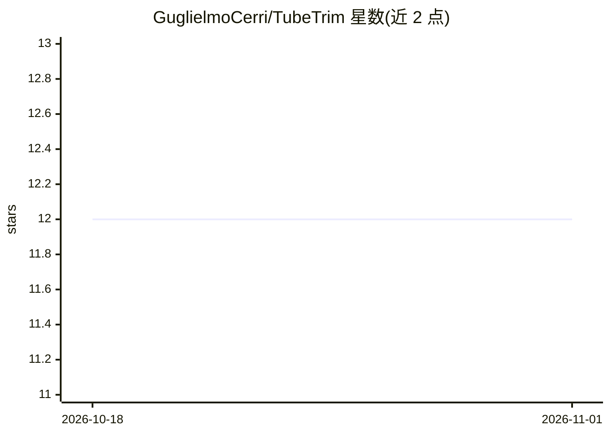

# GuglielmoCerri/TubeTrim

⭐ 12 · Python · MIT · 推送 2026-06-30 · [GitHub](https://github.com/GuglielmoCerri/TubeTrim) · 个人维护

**本地运行的开源 YouTube 视频摘要工具，支持 12 种语言**

在用户本机运行的 YouTube 视频摘要应用：通过 youtube-transcript-api 抓取字幕（不做语音转写），超长文本先用 TF-IDF 式词频抽句压缩约一半，再按句子边界分块（≤4000 字符）送入本地 Hugging Face 模型（默认 Qwen2.5-1.5B-Instruct）生成指定语言摘要与 5 个标签。后端 FastAPI 提供 HTTP/NDJSON 流式接口，前端 Gradio 网页 UI。自动检测 NVIDIA GPU（bfloat16）、Apple Silicon MPS（float16）或 CPU（float32）三种推理精度，无需 API key。需 Python 3.10+ 与 uv，模型约 3.5 GB 首次请求时自动下载。

## 筛选速览

| 维度 | 判定 | 备注 |
|---|---|---|
| AI 角色 | `ai-native` | 本体是模型或模型工具 |
| 许可风险 | `permissive` | MIT |
| 部署形态 | `None` |  |
| 模型依赖 | — | README 未给出锁定关系 |
| 硬件要求 | — | 无带数字的原话,不猜 |
| 安装摩擦 | `medium` | 含编译或系统依赖之一 |
| 成熟度 | — | 结构信号不足 |

## 能力要点

- 仅读取字幕，不做音频下载与语音转写
- TF-IDF 式抽句预压缩约 50%，再按句子边界分块送入 LLM
- CUDA / MPS / CPU 自动检测与动态精度选择，本地推理无需 API key
- FastAPI + NDJSON 流式接口与 Gradio 网页 UI

## 适用场景

- 把 YouTube 视频字幕快速转成指定语言的文字摘要
- 无需 API key、数据不出本机地对视频内容做摘要
- 通过 HTTP API 在自己的工作流中调用视频摘要

## 场景标签

`AI 写作` · 领域:内容生成

## 证据(README 行号)

> L17: A free, open-source YouTube video summarizer that runs locally on your machine. Automatically detects and utilizes 
> L31: 4. **LLM summarization**: Each chunk is passed to the language model, which generates a summary and 5 relevant hash

## 星数曲线

2026-10-18 12 → 2026-11-01 12（+0）

---
*卡片 v1 · prompt 1.4 · 生成 2026-11-01 · 置信度 high · 依据 README sha `0997fd63b1d3` · [字段定义](../../DATASET.md)*
