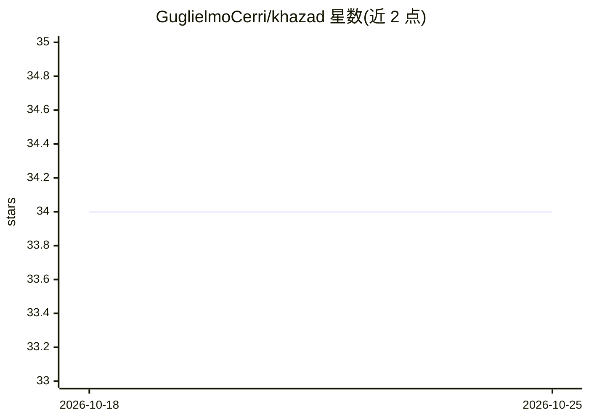

# GuglielmoCerri/khazad

⭐ 34 · Python · MIT · 推送 2026-07-10 · [GitHub](https://github.com/GuglielmoCerri/khazad) · 个人维护

**为 LLM API 调用做透明传输层语义缓存的 Python 库**

基于 Redis 8 Vector Sets 的语义缓存库：在 httpx 传输层拦截 LLM HTTP 流量，将语义等价的请求（按余弦相似度阈值判定）从 Redis 向量缓存中回放，无需修改应用代码。按 (provider, model) 或 host 划分缓存作用域，缓存命中以 SSE 流回放，支持流式/非流式互转。覆盖 OpenAI、Azure OpenAI、OpenAI 兼容代理（vLLM/Ollama）、Anthropic 等 httpx 系 SDK；基于 requests/aiohttp/boto3（AWS Bedrock）的 SDK 不被拦截。响应明文存于 Redis，Gemini 流式请求直通不缓存。提供 get_stats 指标与 hosts 白名单。

## 筛选速览

| 维度 | 判定 | 备注 |
|---|---|---|
| AI 角色 | `ai-ecosystem` | LLM/agent 周边工具 |
| 许可风险 | `permissive` | MIT |
| 部署形态 | `self-host` | docker 或自建部署 |
| 模型依赖 | local-ok | 支持本地模型 |
| 硬件要求 | — | 无带数字的原话,不猜 |
| 安装摩擦 | `low` | 无编译、无系统依赖或容器化 |
| 成熟度 | — | 结构信号不足 |

## 能力要点

- 传输层补丁拦截 httpx 流量，应用代码零改动
- 按 (provider, model) 或 host 两种缓存作用域，模型间不串答案
- 缓存命中以 SSE 流回放，流式/非流式响应可互用
- 默认 HuggingFace 本地嵌入（免费），可选 OpenAI 嵌入后端

## 适用场景

- 高重复流量场景（FAQ 机器人、客服助手）减少 API 调用与支出
- 开发/测试/CI 环境避免为相同 prompt 重复付费
- 演示与压测中获得确定性即时响应

## 场景标签

 · 领域:LLM 基础设施/缓存

## 证据(README 行号)

> L22: Khazad intercepts LLM HTTP traffic at the **transport layer** and serves semantically equivalent requests from a Re
> L30: - **Model-aware** — each `(provider, model)` pair gets its own vector set, so a `gpt-4o` answer is never served to 

## 星数曲线

2026-10-18 34 → 2026-10-25 34（+0）

---
*卡片 v1 · prompt 1.4 · 生成 2026-10-25 · 置信度 mid · 依据 README sha `98dc32c1965a` · [字段定义](../../DATASET.md)*
