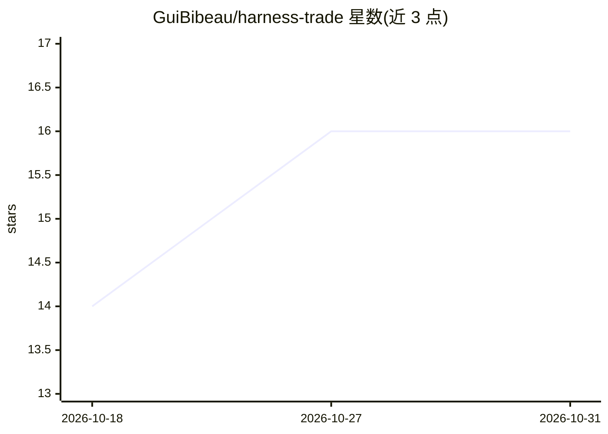

# GuiBibeau/harness-trade

⭐ 16 · TypeScript · Apache-2.0 · 推送 2026-09-19 · [GitHub](https://github.com/GuiBibeau/harness-trade) · [官网](https://harness.trade) · 个人维护

**开源 Solana 交易终端：单账户交易 Phoenix 永续与 Jupiter 现货**

面向交易者的开源 Solana 交易终端（SvelteKit + Bun 构建），支持在同一 USDC 账户下交易 Phoenix 永续合约与 Jupiter 现货；提供 K 线、订单簿、资金费率、图表上直接交易（结构位、点击下单、可拖拽止盈止损）、风险仓位管理、交易日志与提醒、资金费率向导等功能。AI 功能通过用户自带的 OpenAI/Anthropic/DeepSeek/xAI 密钥接入，密钥以 AES-256-GCM 加密存储并支持轮换。零环境变量即可启动，设置 Privity App ID 与 Solana RPC 后启用钱包与实盘交易。

## 筛选速览

| 维度 | 判定 | 备注 |
|---|---|---|
| AI 角色 | `ai-enhanced` | 去掉 AI 部分产品仍成立 |
| 许可风险 | `permissive` | Apache-2.0 |
| 部署形态 | `None` |  |
| 模型依赖 | locked-api |  |
| 硬件要求 | — | 无带数字的原话,不猜 |
| 安装摩擦 | `low` | 无编译、无系统依赖或容器化 |
| 成熟度 | — | 结构信号不足 |

## 能力要点

- 单 USDC 账户同时交易 Phoenix 永续与 Jupiter 现货
- 图表原生交易：点击下单、可拖拽 TP/SL、射线与测量工具
- 用户自带 LLM 密钥，AES-256-GCM 加密存储并支持密钥轮换
- 零环境变量启动，逐步配置即可启用钱包与实盘

## 适用场景

- 在一个终端内交易 Solana 永续与现货
- 在图表上直接下单并管理止盈止损
- 用自带 API 密钥使用终端的 AI 功能

## 场景标签

`金融量化` · 领域:学习与行业

## 证据(README 行号)

> L7: Harness is an open-source trading terminal for Solana — perps and spot from
> L8: one account, with AI you hold the reins on.
> L37: User-supplied OpenAI, Anthropic, DeepSeek, and xAI/Grok keys require

## 星数曲线

2026-10-18 14 → 2026-10-31 16（+2）

---
*卡片 v1 · prompt 1.4 · 生成 2026-10-30 · 置信度 high · 依据 README sha `b86d46a32498` · [字段定义](../../DATASET.md)*
