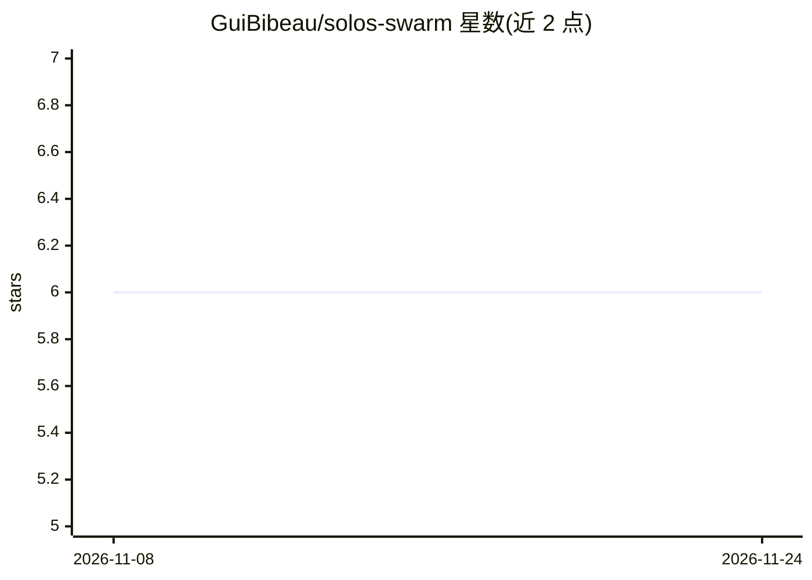

# GuiBibeau/solos-swarm

⭐ 6 · Rust · Apache-2.0 · 推送 2026-11-09 · [GitHub](https://github.com/GuiBibeau/solos-swarm) · 个人维护

**预算受控的 Linux 沙箱 AI 编码 agent 运行器（swarm/agent 双模式）**

单个 Rust 二进制，在 Linux 上运行沙箱化 AI 编码 agent。核心机制：broker 代理所有 LLM 调用使 agent 不持有 API key，以整数 microUSD 记账每次调用的成本并对预算结算，暂停期间拒绝调用；agent 运行在 bubblewrap 沙箱中，事件写入哈希链日志。Swarm 模式以 1-30 个 Pi agent 协作完成一个目标；agent 常驻模式接收来自 Discord、Slack、GitHub 与 MCP 主机（如 Claude Code）的请求，经 Router 模型判定后生成 Ticket 执行。需 Linux、Rust 1.96.0 与 bwrap；forge 仅支持 GitHub。

## 筛选速览

| 维度 | 判定 | 备注 |
|---|---|---|
| AI 角色 | `ai-ecosystem` | LLM/agent 周边工具 |
| 许可风险 | `permissive` | Apache-2.0 |
| 部署形态 | `None` |  |
| 模型依赖 | locked-api |  |
| 硬件要求 | — | 无带数字的原话,不猜 |
| 安装摩擦 | `low` | 无编译、无系统依赖或容器化 |
| 成熟度 | — | 结构信号不足 |

## 能力要点

- broker 统一代理模型调用并以 microUSD 预算记账结算，agent 不持有 key
- bubblewrap 沙箱与哈希链审计日志
- swarm 模式 1-30 个 Pi agent 共享 Board 协作产出 artifact
- agent 模式接入 Discord、Slack、GitHub 与 MCP 主机，回复来源线程

## 适用场景

- 在固定预算内批量运行多个编码 agent 完成一个目标
- 通过 GitHub issue 或 Discord 让常驻 agent 代为处理任务并产出 PR
- 对 agent 的模型调用成本与密钥安全做审计管控

## 场景标签

`编码 Agent` `多智能体` · 领域:Agent 开发

## 证据(README 行号)

> L11: solos-swarm runs AI coding agents on Linux under a governed kernel. A broker makes every model call for the agents,
> L14: event goes to a hash-chained log. One Rust workspace builds one binary, `solos-swarm`, with two modes on that kerne
> L74: The two modes share the model gateway (`src/gateway/`: prices, providers, the upstream request and the pause gate),

## 星数曲线

2026-11-08 6 → 2026-11-24 6（+0）

---
*卡片 v1 · prompt 1.4 · 生成 2026-11-20 · 置信度 high · 依据 README sha `eadc798ca8c0` · [字段定义](../../DATASET.md)*
