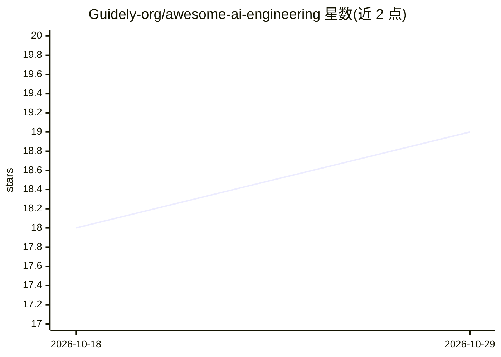

# Guidely-org/awesome-ai-engineering

⭐ 19 · 推送 2025-12-12 · [GitHub](https://github.com/Guidely-org/awesome-ai-engineering) · 组织维护

**AI 工程学习资源、框架与库的策展清单**

由 Guidely 维护的 AI 工程资源汇总清单：学习资源部分按入门、数学、机器学习、深度学习、LLM、提示工程、RAG、AI Agents、MCP、评测、数据集工程、生产部署等主题收录课程、书籍与视频；框架部分列出通用 AI 框架、LLM 开发、Agent 框架、评测、可观测性、数据集框架；库部分覆盖核心 ML、NLP/LLM、向量数据库、数据处理与工具库。面向学习 AI 工程的开发者与学习者，为纯静态清单，无可安装本体。

## 筛选速览

| 维度 | 判定 | 备注 |
|---|---|---|
| AI 角色 | `ai-knowledge` | 知识聚合/清单类 |
| 许可风险 | `none` | — |
| 部署形态 | `None` |  |
| 模型依赖 | — | README 未给出锁定关系 |
| 硬件要求 | — | 无带数字的原话,不猜 |
| 安装摩擦 | `low` | 无编译、无系统依赖或容器化 |
| 成熟度 | — | 结构信号不足 |

## 能力要点

- 按 12+ 主题组织学习资源，标注免费与付费替代
- 收录 Agent/评测/可观测性/数据集等框架条目
- 覆盖核心 ML、LLM、向量数据库与数据处理库

## 适用场景

- 系统查找 AI 工程各阶段的学习课程与书籍
- 选型时浏览常用的 AI 框架与库的清单
- 了解 RAG、Agents、MCP、评测等方向的学习路径

## 场景标签

`精选清单` `教程课程` · 领域:学习与行业

## 证据(README 行号)

> L3: A curated list of truly awesome AI engineering learning resources, frameworks and libraries.
> L20: ## Learning resources

## 星数曲线

2026-10-18 18 → 2026-10-29 19（+1）

---
*卡片 v1 · prompt 1.4 · 生成 2026-10-29 · 置信度 high · 依据 README sha `d14b3c169ece` · [字段定义](../../DATASET.md)*
