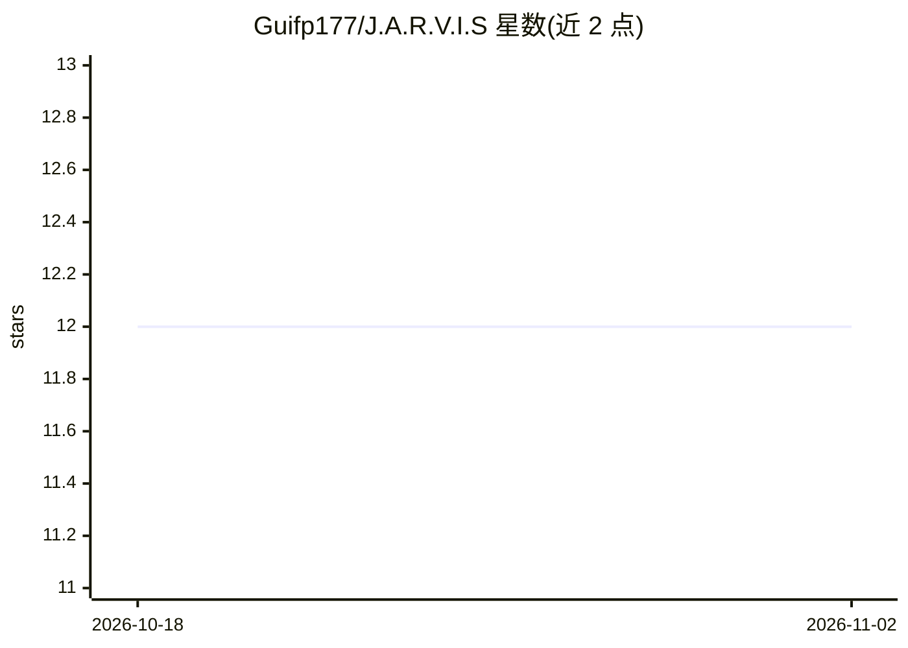

# Guifp177/J.A.R.V.I.S

⭐ 12 · Python · GPL-3.0 · 推送 2026-05-26 · [GitHub](https://github.com/Guifp177/J.A.R.V.I.S) · [官网](https://jarvis-7u3.pages.dev/) · 个人维护

**Windows 本地个人 AI 语音助手，灵感来自钢铁侠 J.A.R.V.I.S.**

Python 编写的桌面智能助手，带 PyQt 图形界面，集成 Ollama（云端免费/付费或本地模型）。功能包括语音识别、男声语音输出、持久化记忆（memory_store.json）、网页搜索、静音模式，通过 .bat 脚本启动。运行需 Windows 10/11、Python 3.10+，另需 Ollama 与 Gemini API 账号；Releases 提供 Portable EXE 版本。项目为非官方粉丝致敬作品，仅供教育与研究用途。

## 筛选速览

| 维度 | 判定 | 备注 |
|---|---|---|
| AI 角色 | `ai-native` | 本体是模型或模型工具 |
| 许可风险 | `viral` | GPL-3.0 |
| 部署形态 | `library` | 以包/库形式分发 |
| 模型依赖 | local-ok | 支持本地模型 |
| 硬件要求 | — | 无带数字的原话,不猜 |
| 安装摩擦 | `low` | 无编译、无系统依赖或容器化 |
| 成熟度 | `idea` | |

## 能力要点

- 语音识别与男声语音输出，支持静音模式
- 持久化记忆存储于 memory_store.json
- Ollama 云端或本地模型接入
- Releases 提供 Portable EXE 可直接运行

## 适用场景

- 在 Windows 上通过语音与本地 AI 助手对话
- 需要一个带记忆和网页搜索的桌面助手
- 离线/本地模型运行的语音交互体验

## 场景标签

`AI 助手` `语音 Agent` · 领域:对话与助手

## 证据(README 行号)

> L6: Assistente inteligente local inspirado no J.A.R.V.I.S. do Tony Stark do MCU, desenvolvido em Python, com interface g
> L26: Interface gráfica em PyQt
> L27: Reconhecimento de voz

## 星数曲线

2026-10-18 12 → 2026-11-02 12（+0）

---
*卡片 v1 · prompt 1.4 · 生成 2026-11-01 · 置信度 high · 依据 README sha `cff29d6812a2` · [字段定义](../../DATASET.md)*
