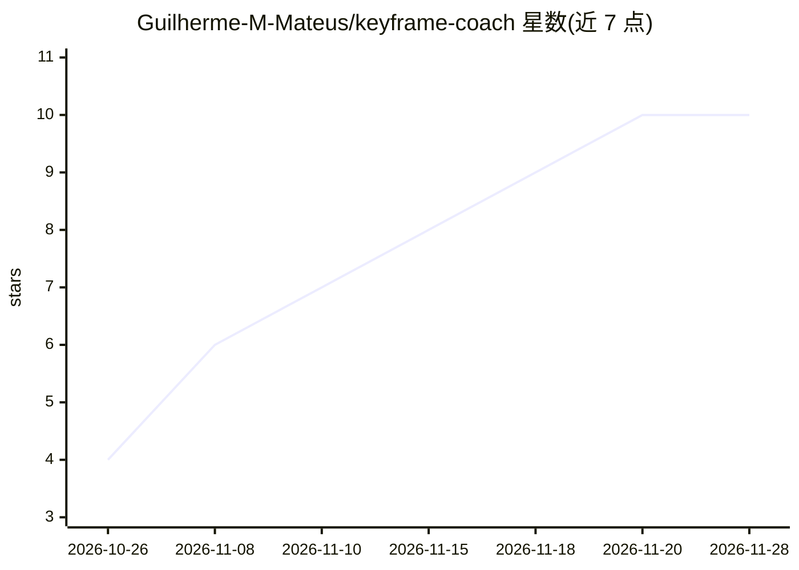

# Guilherme-M-Mateus/keyframe-coach

⭐ 10 · Python · MIT · 推送 2026-10-21 · [GitHub](https://github.com/Guilherme-M-Mateus/keyframe-coach) · 个人维护

**驱动 Blender 做游戏动画的 Claude Code 技能**

以 Claude Code 插件/技能形式发布，向 Claude 注入适配游戏的动画十二法则与工作流（规划帧时序、摆关键姿势、细化、审计、渲染检查、导出），通过官方 MCP for Blender 连接器或无头模式后台驱动 Blender。支持两足、四足、昆虫三足步态与蜘蛛四足步态，自带只读审计脚本检查循环接缝、脚滑动、穿地、四元数翻转等问题，导出面向 Unity/Unreal/Godot/Roblox。需 Claude Code 与 Blender 4.2+。

## 筛选速览

| 维度 | 判定 | 备注 |
|---|---|---|
| AI 角色 | `ai-native` | 本体是模型或模型工具 |
| 许可风险 | `permissive` | MIT |
| 部署形态 | `None` |  |
| 模型依赖 | locked-api |  |
| 硬件要求 | — | 无带数字的原话,不猜 |
| 安装摩擦 | `low` | 无编译、无系统依赖或容器化 |
| 成熟度 | — | 结构信号不足 |

## 能力要点

- 只读审计脚本捕获循环接缝、脚滑动/穿地、四元数翻转、引擎丢弃的缩放键等 9 类问题
- 多足步态指南：四足 walk/trot/gallop、昆虫三足步态、蜘蛛四足步态
- 支持无头模式（blender 命令在 PATH 即可）与 MCP for Blender 实时连接两种运行方式
- 按导出目标引擎处理缩放、叶骨骼、循环与根运动

## 适用场景

- 为游戏角色生成走/跑/冲刺循环动画并导出到 Unity 或 Unreal
- 审计现有动画：脚滑动、穿地、循环接缝等常见问题定位
- 从 GIF 参考复刻人类制作的动画
- 为蜘蛛等多足角色生成步态动画

## 场景标签

 · 领域:游戏开发/动画工具

## 证据(README 行号)

> L3: **A Claude Code skill that animates in Blender like a game animator would.**
> L5: Keyframe Coach teaches Claude the 12 principles of animation, adapted for games, and gives it a workflow to drive Bl

## 星数曲线

2026-10-26 4 → 2026-11-28 10（+6）

---
*卡片 v1 · prompt 1.4 · 生成 2026-11-20 · 置信度 high · 依据 README sha `7f4c91e1ca53` · [字段定义](../../DATASET.md)*
