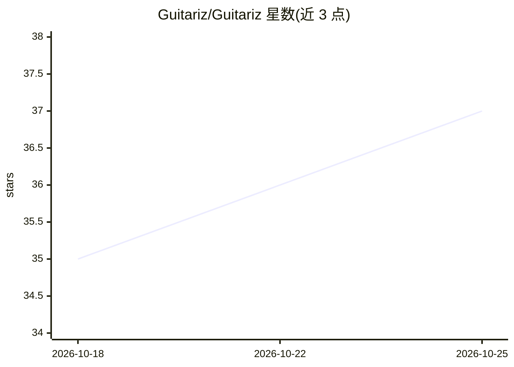

# Guitariz/Guitariz

⭐ 37 · TypeScript · MIT · 推送 2026-10-18 · [GitHub](https://github.com/Guitariz/Guitariz) · [官网](https://guitariz.studio) · 个人维护

**面向音乐人的全栈音乐学习平台：AI 和弦识别与分轨 + 交互乐理工具**

React/Vite 前端 + FastAPI/PyTorch 后端的全栈 Web 应用（PWA），面向吉他手、钢琴学习者、创作者与制作人。AI 能力由服务端 Python 后端提供：基于 Librosa（CQT chroma、HPSS）与 HMM 的和弦识别、基于 Meta Demucs 的人声分离与 4+ 轨分轨、BPM 与调性检测。非 AI 部分包括虚拟指板/88 键钢琴、50+ 音阶可视化、游戏化练耳、Raga 理论浏览及 MIDI 导出。后端为可选组件，仅 AI 功能需要；首次启动会下载约 300MB 的 Demucs 模型。

## 筛选速览

| 维度 | 判定 | 备注 |
|---|---|---|
| AI 角色 | `ai-enhanced` | 去掉 AI 部分产品仍成立 |
| 许可风险 | `permissive` | MIT |
| 部署形态 | `library` | 以包/库形式分发 |
| 模型依赖 | — | README 未给出锁定关系 |
| 硬件要求 | — | 无带数字的原话,不猜 |
| 安装摩擦 | `low` | 无编译、无系统依赖或容器化 |
| 成熟度 | — | 结构信号不足 |

## 能力要点

- 上传音频的和弦识别（Librosa CQT chroma + HMM 后备）与 MIDI 导出
- 基于 Meta Demucs 的人声提取与分轨（ vocals/drums/bass 等）
- 交互式 24 品指板、88 键钢琴与 50+ 音阶可视化
- 游戏化练耳（音程/和弦/绝对音感）与 Raga 理论浏览

## 适用场景

- 上传歌曲识别和弦、BPM 与调性并导出 MIDI 到 DAW
- 制作人做人声提取或分轨用于混音/卡拉OK
- 通过虚拟指板、练耳模块学习乐理

## 场景标签

 · 领域:音乐教育/音频工具

## 证据(README 行号)

> L44: |**Chord AI**|Upload any audio file for high-accuracy chord recognition, powered by **Librosa** (CQT chroma, HPSS, 
> L50: |**Stem Separator**|Isolate vocals, drums, bass, and other instruments using Meta's state-of-the-art **Demucs** dee
> L57: |**Ear Training Arcade**|Gamified modules for **interval recognition**, **chord identification**, and **perfect pit

## 星数曲线

2026-10-18 35 → 2026-10-25 37（+2）

---
*卡片 v1 · prompt 1.4 · 生成 2026-10-25 · 置信度 mid · 依据 README sha `b71ea96cc768` · [字段定义](../../DATASET.md)*
