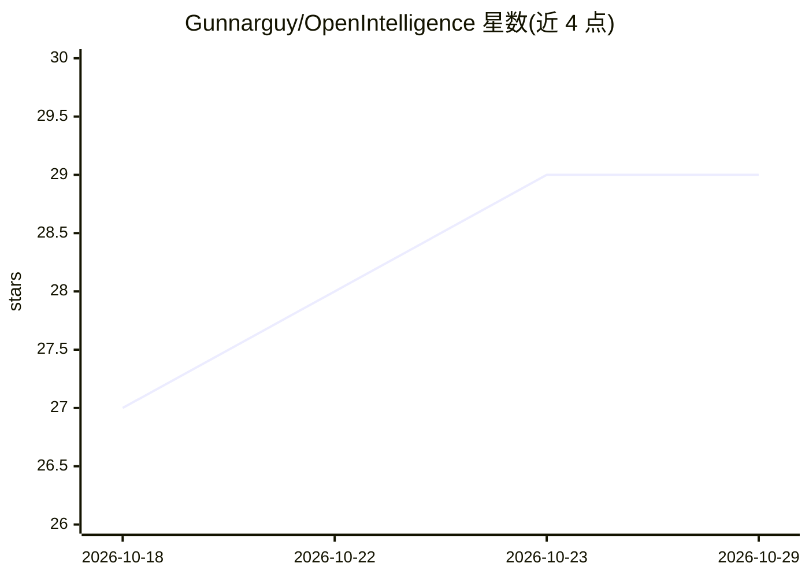

# Gunnarguy/OpenIntelligence

⭐ 29 · Swift · MIT · 推送 2026-10-27 · [GitHub](https://github.com/Gunnarguy/OpenIntelligence) · [官网](https://apps.apple.com/us/app/openintelligence/id6756559175) · 个人维护

**本地优先的 Apple 平台文档问答应用：引用溯源、离线运行**

面向 iPhone/iPad/Mac 的文档智能应用：导入 PDF、Office 文件、代码、图片、音视频后建立本地可搜索索引，以带页码引用的方式回答问题。检索采用向量+BM25 混合搜索、RRF 融合、交叉编码器重排与 MMR 多样化，回答前经过验证门核查是否基于检索文本。摄取、索引、检索、验证全程本地执行，无账号与第三方 AI 服务；iOS/macOS 27+ 可选允许 Apple Private Cloud Compute 撰写最终答案，并显示实际执行位置徽章。限制：Pages/Numbers/Keynote 不可直接读取需先导出；Standard 模式实测 QASPER 精确匹配率 0.410，Deep Think/Maximum 尚无测得分数。

## 筛选速览

| 维度 | 判定 | 备注 |
|---|---|---|
| AI 角色 | `ai-native` | 本体是模型或模型工具 |
| 许可风险 | `permissive` | MIT |
| 部署形态 | `None` |  |
| 模型依赖 | — | README 未给出锁定关系 |
| 硬件要求 | — | 无带数字的原话,不猜 |
| 安装摩擦 | `low` | 无编译、无系统依赖或容器化 |
| 成熟度 | — | 结构信号不足 |

## 能力要点

- 向量+BM25 混合检索，RRF 融合、交叉编码器重排、MMR 多样化
- 每个回答带可点击核查的页码引用，回答前经过落地性验证门
- 摄取/索引/检索/验证全本地，可选 PCC 撰写答案并显示实际执行位置徽章
- 支持 500+ 页 PDF 与超大文件的分批断点导入，集成 Siri/Shortcuts/Spotlight

## 适用场景

- 在不联网、不上传文件的前提下问答自己的医学/法律/财务等敏感文档
- 研究论文库中查找具体零件号或概念性问题并获得可核查的出处
- 通过 Siri、快捷指令与 Spotlight 直接检索个人文档库

## 场景标签

`文档问答` · 领域:知识与检索

## 证据(README 行号)

> L12: Drop in PDFs, Office files, code, images, audio, or video. OpenIntelligence reads
> L13: them, builds a private searchable index, and answers questions about them with
> L18: **It runs on your device.** Ingestion, indexing, retrieval, ranking, and

## 星数曲线

2026-10-18 27 → 2026-10-29 29（+2）

---
*卡片 v1 · prompt 1.4 · 生成 2026-10-26 · 置信度 high · 依据 README sha `d515f1964174` · [字段定义](../../DATASET.md)*
