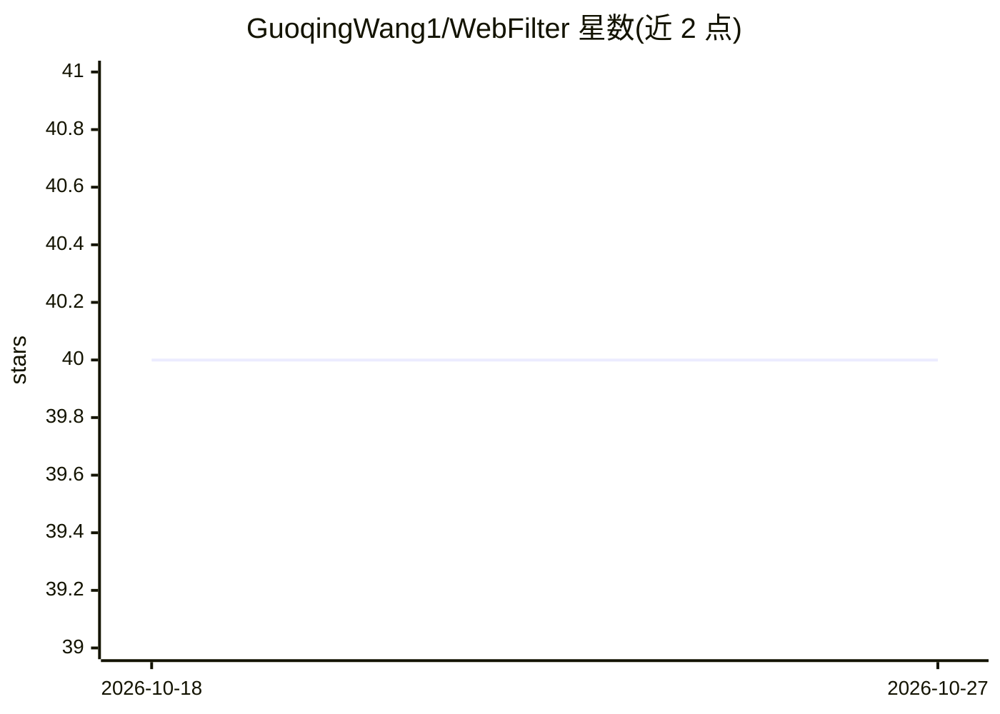

# GuoqingWang1/WebFilter

⭐ 40 · Python · Apache-2.0 · 推送 2025-11-09 · [GitHub](https://github.com/GuoqingWang1/WebFilter) · 组织维护

**AAAI26 论文代码：RL 训练 agentic RAG 做来源受限查询与噪声过滤**

AAAI 2026 论文 WebFilter 的官方代码仓库。本体是一个 agentic RAG 训练框架：通过强化学习（PPO/GRPO）与行为-结果双驱动奖励，优化查询构造与检索结果，生成来源受限的查询并过滤不可靠网页内容。提供 7B 检查点（Hugging Face），依赖 veRL/Search-r1 等实现，训练与奖励评估需配置搜索引擎 API（Serper/Azure Bing）与 Qwen API key，RR 模式另需 vllm 起奖励模型服务。面向复现论文或继续训练模型的科研用户。

## 筛选速览

| 维度 | 判定 | 备注 |
|---|---|---|
| AI 角色 | `ai-native` | 本体是模型或模型工具 |
| 许可风险 | `permissive` | Apache-2.0 |
| 部署形态 | `library` | 以包/库形式分发 |
| 模型依赖 | local-ok | 支持本地模型 |
| 硬件要求 | — | 无带数字的原话,不猜 |
| 安装摩擦 | `low` | 无编译、无系统依赖或容器化 |
| 成熟度 | — | 结构信号不足 |

## 能力要点

- 强化学习（PPO/GRPO）训练查询构造与检索过滤，含 SR 与 SR-RR 两种奖励函数
- WebFilter-7B 检查点发布于 Hugging Face Hub
- 提供训练（train_grpo.sh）、评测（evaluate.sh）与指标计算脚本
- 后端 handler 支持 Serper 与 Azure Bing 搜索引擎配置

## 适用场景

- 复现论文中 agentic RAG 的强化学习训练流程
- 基于 WebFilter-7B 做问答与检索评测
- 研究来源受限查询构造对检索可靠性的影响

## 场景标签

`RAG` `强化学习` `科研工具` · 领域:知识与检索

## 证据(README 行号)

> L18:  WebFilter, a novel agentic RAG framework that generates source-restricted queries and filters out unreliable conte
> L78: ### 🏋️‍♂️ Training the model

## 星数曲线

2026-10-18 40 → 2026-10-27 40（+0）

---
*卡片 v1 · prompt 1.4 · 生成 2026-10-25 · 置信度 low · 依据 README sha `e7420dc381f6` · [字段定义](../../DATASET.md)*
