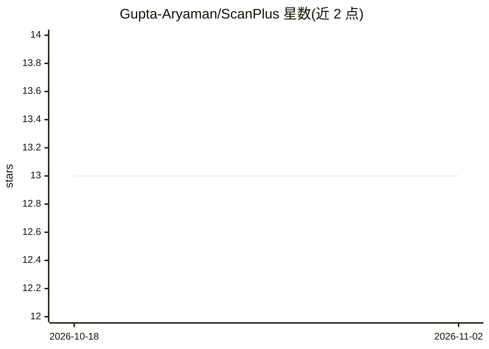

# Gupta-Aryaman/ScanPlus

⭐ 13 · Python · MIT · 推送 2026-08-20 · [GitHub](https://github.com/Gupta-Aryaman/ScanPlus) · [官网](https://aryaman.space/from-scribbles-to-structured-data-processing-handwritten-prescriptions-with-spark-nlp/) · 个人维护

**将医生手写处方转为结构化文本并分类药品、定时提醒的系统**

面向患者用药场景的系统：用 AWS Textract 对手写处方做 OCR，再经 BERT 嵌入 + Char CNN-BiLSTM + CRF 的 NER 模型，抽取药品名称、剂量与服用时间等结构化信息，并通过邮件向患者注册邮箱发送处方详情与按时间表的服药提醒（依赖 Cron Jobs）。前后端各以 Flask 应用运行，需配置 AWS 凭证并在本地训练 NER 模型后使用。

## 筛选速览

| 维度 | 判定 | 备注 |
|---|---|---|
| AI 角色 | `ai-native` | 本体是模型或模型工具 |
| 许可风险 | `permissive` | MIT |
| 部署形态 | `library` | 以包/库形式分发 |
| 模型依赖 | — | README 未给出锁定关系 |
| 硬件要求 | — | 无带数字的原话,不猜 |
| 安装摩擦 | `low` | 无编译、无系统依赖或容器化 |
| 成熟度 | — | 结构信号不足 |

## 能力要点

- AWS Textract 手写处方 OCR 文本提取
- BERT+Char CNN-BiLSTM+CRF 的 NER 模型抽取药品名、剂量与服用时间
- 邮件提醒系统按定时任务发送服药提醒
- 前后端均为 Flask 应用，提供 REST API

## 适用场景

- 把手写处方数字化为可读的药品与剂量清单
- 按时收到服药邮件提醒
- 对处方文本做药品相关实体分类

## 场景标签

`OCR` `文档解析` · 领域:知识与检索

## 证据(README 行号)

> L4: A system that can convert doctor's handwritten prescriptions into machine-readable text and classify the medicines a
> L8: * NER Model: Classifies the extracted text into relevant categories.
> L25:  - **BERT Embedding:** Converts the input text into context-aware embeddings.

## 星数曲线

2026-10-18 13 → 2026-11-02 13（+0）

---
*卡片 v1 · prompt 1.4 · 生成 2026-10-31 · 置信度 mid · 依据 README sha `3b3a8b9fa978` · [字段定义](../../DATASET.md)*
