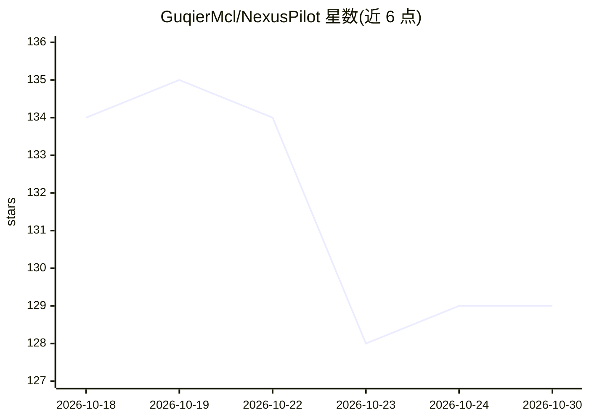

# GuqierMcl/NexusPilot

⭐ 129 · TypeScript · Apache-2.0 · 推送 2026-10-20 · [GitHub](https://github.com/GuqierMcl/NexusPilot) · [官网](https://nexuspilot.dev) · 个人维护 · 中文 README

**AI 原生跨平台数据库工作台：自然语言查询与操作多种数据库**

面向开发者与数据团队的多数据库桌面工作台，基于 Tauri v2、React 19 与 Rust 构建。支持 PostgreSQL、MySQL、SQLite、Redis、ClickHouse、Oracle 的连接、对象浏览、查询编辑与数据变更。AI 部分：本地 AI Runtime sidecar（Bun + Elysia + Vercel AI SDK）提供 Ask/Query/Agent 模式的自然语言数据代理，通过受限工作台工具与审批流执行操作；自带 provider 配置并同步 models.dev 目录。README 声明不开启 AI 功能时工作台仍可用；NexusPilot Cloud 同步为独立商业服务。

## 筛选速览

| 维度 | 判定 | 备注 |
|---|---|---|
| AI 角色 | `ai-enhanced` | 去掉 AI 部分产品仍成立 |
| 许可风险 | `permissive` | Apache-2.0 |
| 部署形态 | `desktop` | 安装包/桌面程序 |
| 模型依赖 | — | README 未给出锁定关系 |
| 硬件要求 | — | 无带数字的原话,不猜 |
| 安装摩擦 | `low` | 无编译、无系统依赖或容器化 |
| 成熟度 | — | 结构信号不足 |

## 能力要点

- 6 种数据库（PostgreSQL/MySQL/SQLite/Redis/ClickHouse/Oracle）的引擎感知查询与对象管理
- 自然语言 Agent 通过受限工具与风险审批流操作数据库，SQL/Redis 写入需审批
- 本地 AI Runtime sidecar 管理 provider/model 与凭据，支持自定义 OpenAI 兼容 provider
- 端到端加密的设备间连接同步（可选云服务）

## 适用场景

- 在一个客户端里管理多种关系型、KV 与分析型数据库
- 用自然语言提问并让 Agent 代为查询、探索和操作数据
- 对 Redis 键值、TTL 及 ClickHouse 投影/索引等引擎原生对象做管理

## 场景标签

`数据分析` · 领域:效率与自动化

## 证据(README 行号)

> L26: - **Bring-your-own models with a local AI Runtime** — manage providers, models, and credentials in the local AI Run
> L114: - You can use the database workbench without enabling AI features or NexusPilot Cloud.

## 星数曲线

2026-10-18 134 → 2026-10-30 129（-5）

---
*卡片 v1 · prompt 1.4 · 生成 2026-10-22 · 置信度 high · 依据 README sha `9f49c44ad93b` · [字段定义](../../DATASET.md)*
