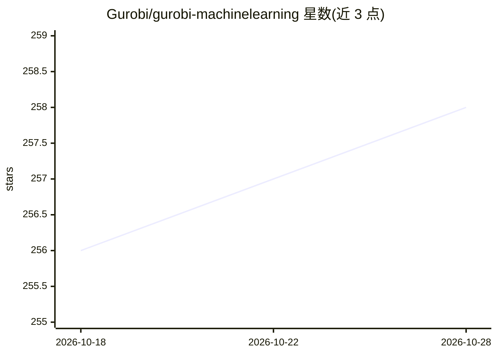

# Gurobi/gurobi-machinelearning

⭐ 258 · Python · Apache-2.0 · 推送 2026-10-26 · [GitHub](https://github.com/Gurobi/gurobi-machinelearning) · [官网](https://gurobi-machinelearning.readthedocs.io/) · 组织维护

**将训练好的 ML 预测模型嵌入 Gurobi 优化模型的 Python 包**

由 Gurobi 官方维护的开源 Python 包，把已训练的回归预测器（scikit-learn 各类对象为主）以约束形式嵌入 gurobipy 优化模型中求解，使优化问题可以内生地使用 ML 预测结果。对 Keras、PyTorch、XGBoost 提供有限支持，且 Keras/PyTorch 仅限 ReLU 激活的神经网络。依赖 gurobipy 商业求解器（随附测试用受限免费许可，学术用户可申请完整许可），通过 pip 安装。

## 筛选速览

| 维度 | 判定 | 备注 |
|---|---|---|
| AI 角色 | `ai-ecosystem` | LLM/agent 周边工具 |
| 许可风险 | `permissive` | Apache-2.0 |
| 部署形态 | `library` | 以包/库形式分发 |
| 模型依赖 | — | README 未给出锁定关系 |
| 硬件要求 | — | 无带数字的原话,不猜 |
| 安装摩擦 | `low` | 无编译、无系统依赖或容器化 |
| 成熟度 | — | 结构信号不足 |

## 能力要点

- 支持多种 scikit-learn 回归对象直接嵌入 gurobipy 模型
- 对 Keras、PyTorch、XGBoost 提供有限支持（神经网络限 ReLU 激活）
- pip 安装并自动安装 numpy/scipy/gurobipy 依赖

## 适用场景

- 把已训练的 ML 预测器作为约束嵌入优化模型求解
- 构建含机器学习预测组件的决策优化问题
- 学术研究者在 Gurobi 学术许可下做预测+优化联合建模

## 场景标签

 · 领域:数学优化/机器学习工程

## 证据(README 行号)

> L13: Gurobi Machine Learning is an open-source python package to formulate trained regression models in a `gurobipy` mod
> L15: The package currently supports various scikit-learn objects. It has limited support for Keras, PyTorch and XGBoost.

## 星数曲线

2026-10-18 256 → 2026-10-28 258（+2）

---
*卡片 v1 · prompt 1.4 · 生成 2026-10-22 · 置信度 high · 依据 README sha `9669a9951954` · [字段定义](../../DATASET.md)*
