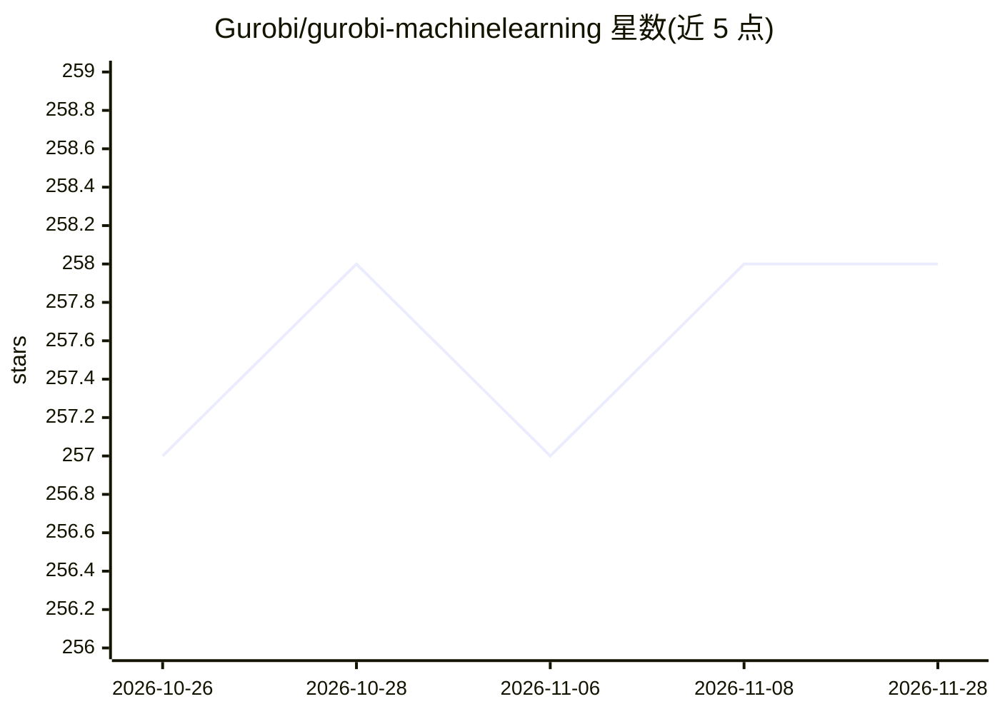

# Gurobi/gurobi-machinelearning

⭐ 258 · Python · Apache-2.0 · 推送 2026-11-21 · [GitHub](https://github.com/Gurobi/gurobi-machinelearning) · [官网](https://gurobi-machinelearning.readthedocs.io/) · 组织维护

**把训练好的回归模型嵌入 Gurobi 优化模型的 Python 包**

开源 Python 包，将已训练的回归预测器转化为 gurobipy 模型中的表达式，交由 Gurobi 求解器求解。支持多种 scikit-learn 对象以及 XGBoost、LightGBM、ONNX，对 Keras 与 PyTorch 仅有限支持（仅限 ReLU 激活的神经网络）。依赖 Python ≥3.11、numpy、gurobipy、scipy；gurobipy 为商业软件，pip 安装附带仅限小规模模型的免费测试许可，学术用户可申请免费完整许可。文档托管在 readthedocs。

## 筛选速览

| 维度 | 判定 | 备注 |
|---|---|---|
| AI 角色 | `ai-ecosystem` | LLM/agent 周边工具 |
| 许可风险 | `permissive` | Apache-2.0 |
| 部署形态 | `library` | 以包/库形式分发 |
| 模型依赖 | — | README 未给出锁定关系 |
| 硬件要求 | — | 无带数字的原话,不猜 |
| 安装摩擦 | `low` | 无编译、无系统依赖或容器化 |
| 成熟度 | — | 结构信号不足 |

## 能力要点

- 将 sklearn/XGBoost/LightGBM/ONNX 训练模型表述为 Gurobi 优化模型
- 支持 Keras 与 PyTorch 的 ReLU 神经网络（有限支持）
- pip 安装并自动装齐 numpy/scipy/gurobipy 依赖
- 学术机构人员可申请免费完整许可

## 适用场景

- 在运筹优化模型中引入训练好的回归预测器
- 将梯度提升树模型的预测作为优化约束
- 在 Gurobi 求解流程中使用 ONNX 格式模型

## 场景标签

 · 领域:数学优化/机器学习集成

## 证据(README 行号)

> L13: Gurobi Machine Learning is an open-source python package to formulate trained regression models in a `gurobipy` mod
> L15: The package currently supports various scikit-learn objects. It also supports XGBoost, LightGBM, ONNX, and has limi
> L30: - `gurobipy` >= 11.0.0

## 星数曲线

2026-10-26 257 → 2026-11-28 258（+1）

---
*卡片 v1 · prompt 1.4 · 生成 2026-11-25 · 置信度 high · 依据 README sha `7a278afb2596` · [字段定义](../../DATASET.md)*
