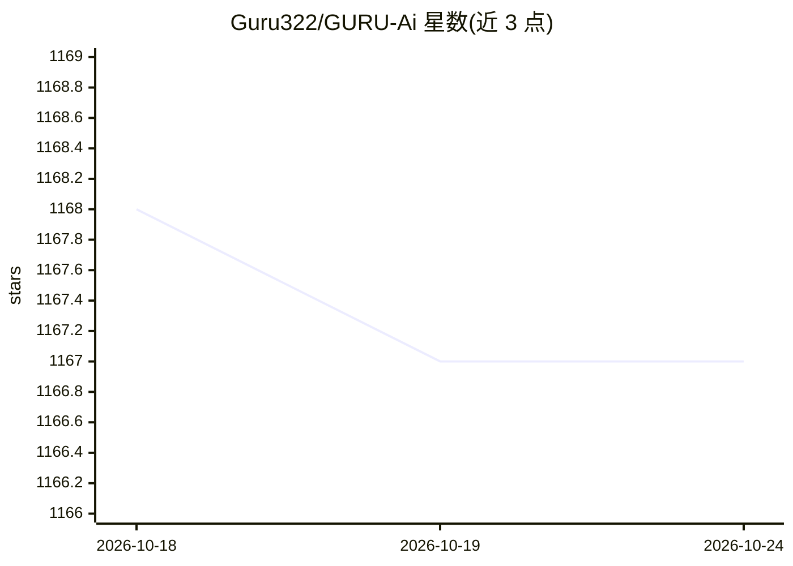

# Guru322/GURU-Ai

⭐ 1,168 · JavaScript · NOASSERTION · 推送 2026-04-15 · [GitHub](https://github.com/Guru322/GURU-Ai) · [官网](http://guru.is-a.dev/) · 个人维护

**通过配对码接入 WhatsApp 的命令式聊天机器人（Node.js）**

以 Node.js 实现的 WhatsApp 机器人：git clone 源码安装并 npm install 依赖，通过 .env 配置 MongoDB 连接、手机号与所有者列表；npm start 启动后默认监听 5000 端口，浏览器访问 localhost:5000 获取配对码，再经 WhatsApp Linked Devices 完成设备配对。命令以 . 为前缀调用（.ping/.menu/.list/.alive 等），config.js 提供机器人名称、贴纸水印等附加设置。仓库主题标签含 ai/chatgpt/openai，但 README 正文未描述具体 AI 功能机制。

## 筛选速览

| 维度 | 判定 | 备注 |
|---|---|---|
| AI 角色 | `ai-enhanced` | 去掉 AI 部分产品仍成立 |
| 许可风险 | `none` | NOASSERTION |
| 部署形态 | `library` | 以包/库形式分发 |
| 模型依赖 | — | README 未给出锁定关系 |
| 硬件要求 | — | 无带数字的原话,不猜 |
| 安装摩擦 | `low` | 无编译、无系统依赖或容器化 |
| 成熟度 | — | 结构信号不足 |

## 能力要点

- 配对码方式接入 WhatsApp（Linked Devices 流程）
- 前缀式命令系统（.menu/.list/.help 查看全部命令）
- MongoDB 持久化与 .env/config.js 双层配置
- 内置 Web 配对界面（默认端口 5000）

## 适用场景

- 在自己的 WhatsApp 账号上运行命令式聊天机器人
- 通过 .menu/.list 浏览和调用机器人功能
- 按所有者列表管理机器人控制权限

## 场景标签

`聊天机器人` · 领域:对话与助手

## 证据(README 行号)

> L60:  After starting, the bot will print a pairing code.
> L61: Open WhatsApp > Linked Devices > Link a Device > Link with phone number and enter the pairing code to connect.

## 星数曲线

2026-10-18 1,168 → 2026-10-24 1,167（-1）

---
*卡片 v1 · prompt 1.4 · 生成 2026-10-21 · 置信度 low · 依据 README sha `1a48857dfa6f` · [字段定义](../../DATASET.md)*
