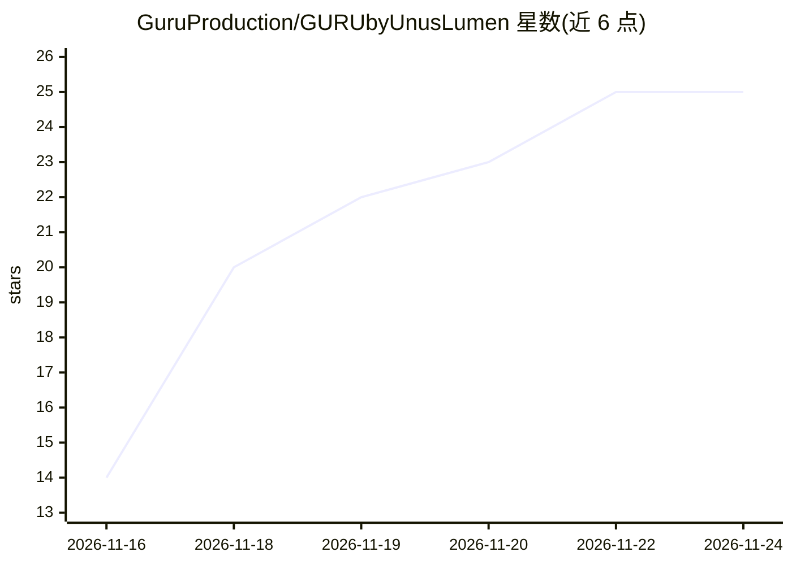

# GuruProduction/GURUbyUnusLumen

⭐ 25 · Kotlin · AGPL-3.0 · 推送 2026-11-22 · [GitHub](https://github.com/GuruProduction/GURUbyUnusLumen) · [官网](https://www.unuslumen.com) · 个人维护

**Android 自进化 AI 代理应用：控制手机与家庭网络设备**

侧载安装的开源 Android 应用，面向消费者。内置约 390 个工具的注册表与 167 项 Android 权限层，通过 UPnP/DIAL/Wake-on-LAN/SSH/ADB 等协议发现并操控电视、主机、灯光、路由器等网络设备；Rust 编写的加密记忆引擎（BUFFER/EPISODIC/SEMANTIC 分层与图结构）；APK 内捆绑 Termux 前缀、CPython、ffmpeg 等完整 Unix userland，无需 root；所有模型调用经内嵌 Tor 出口且 fail-closed；支持本地回环/局域网模型直连（BYOK）。限制：仅 Android、需侧载 APK，Otio 数据市场等层未上线。

## 筛选速览

| 维度 | 判定 | 备注 |
|---|---|---|
| AI 角色 | `ai-native` | 本体是模型或模型工具 |
| 许可风险 | `viral` | AGPL-3.0 |
| 部署形态 | `desktop` | 安装包/桌面程序 |
| 模型依赖 | local-ok | 支持本地模型 |
| 硬件要求 | — | 无带数字的原话,不猜 |
| 安装摩擦 | `medium` | 含编译或系统依赖之一 |
| 成熟度 | — | 结构信号不足 |

## 能力要点

- 约 390 个工具注册表与 167 项 Android 权限层，协议级控制电视/主机/路由器等设备
- Rust 加密记忆引擎：分层记忆结构与带类型边的记忆图
- APK 内捆绑完整 Unix userland（Termux、CPython、ffmpeg、JDK 工具链等），无需 root
- 所有外部请求经内嵌 Tor，未就绪时抛错而非走明网；本地局域网模型直连

## 适用场景

- 用一部手机通过对话控制家中电视、主机、灯光等网络设备
- 让 agent 在后台按记忆与自定义心跳提示自动执行任务
- 在无云端依赖的本地/自配模型环境下运行隐私优先的 AI 助手
- 让 GURU 自行编写缺失的工具与技能来扩展能力

## 场景标签

`AI 助手` `GUI 自动化` · 领域:效率与自动化

## 证据(README 行号)

> L39: It is not a chat app. It is a permission layer across 167 Android permissions, a tool registry of around 390 tools 
> L91: **Portal** is the chat: streaming replies, tool calls you can watch happen, a canvas, attachments, and slash comman

## 星数曲线

2026-11-16 14 → 2026-11-24 25（+11）

---
*卡片 v1 · prompt 1.4 · 生成 2026-11-18 · 置信度 high · 依据 README sha `8a7326700ede` · [字段定义](../../DATASET.md)*
