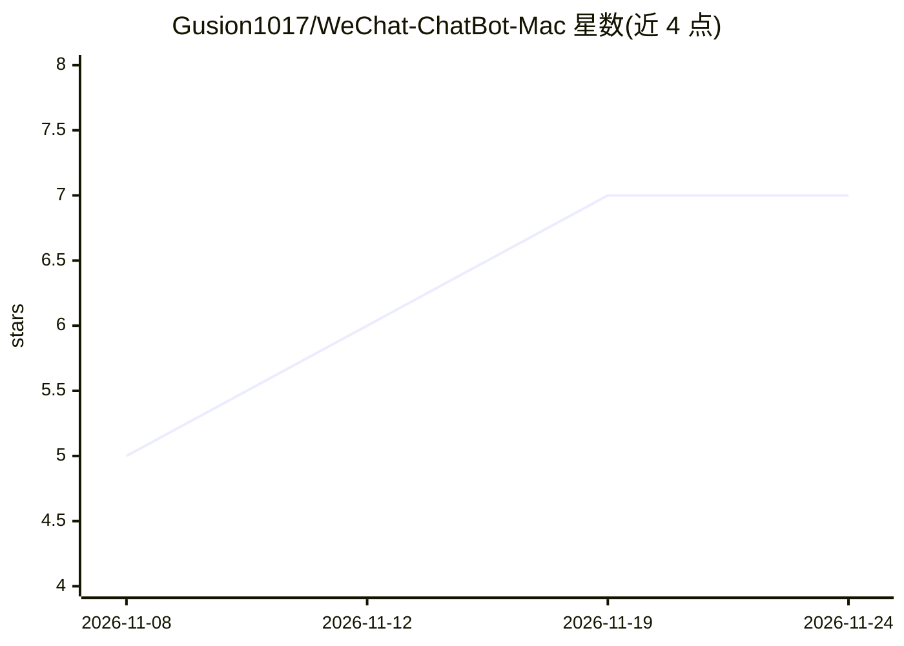

# Gusion1017/WeChat-ChatBot-Mac

⭐ 7 · Swift · GPL-3.0 · 推送 2026-11-22 · [GitHub](https://github.com/Gusion1017/WeChat-ChatBot-Mac) · [官网](https://github.com/Gusion1017/WeChat-ChatBot-Mac/releases/latest) · 个人维护 · 中文 README

**给 macOS 微信用户的本地 AI 聊天机器人：接入大模型自动回复**

基于 SwiftUI + Go + Frida Hook 的 macOS 原生微信 AI 聊天机器人：通过 frida-core 将 Gadget 注入官方微信，以 OneBot v11 协议桥接，实现私聊/群聊自动回复、按会话的长期记忆卡、本地语音转写与 Qwen3-TTS 语音回复、识图、朋友圈互动与定时消息。仅支持特定微信版本与 Apple Silicon + macOS 26+；消息与记忆只存本机。修改微信会破坏官方签名并存在账号风控风险，仅声明用于个人自用/学习研究。

## 筛选速览

| 维度 | 判定 | 备注 |
|---|---|---|
| AI 角色 | `ai-native` | 本体是模型或模型工具 |
| 许可风险 | `viral` | GPL-3.0 |
| 部署形态 | `None` |  |
| 模型依赖 | local-ok | 支持本地模型 |
| 硬件要求 | — | 无带数字的原话,不猜 |
| 安装摩擦 | `low` | 无编译、无系统依赖或容器化 |
| 成熟度 | — | 结构信号不足 |

## 能力要点

- Frida 注入官方微信，经 OneBot v11 暴露消息收发
- 每会话记忆卡：自动提取事实/待办，支持全局共享与导出
- 本地语音转写 + Qwen3-TTS 语音回复（模型需自行安装）
- 支持 DeepSeek 与任意 OpenAI 兼容端点，按会话切换模型与人格

## 适用场景

- 让微信私聊和群聊消息由 AI 自动回复
- 为每个聊天对象维护长期记忆与人格设定
- 在微信里用语音和图片与 AI 对话
- AI 自动互动朋友圈并按计划发动态

## 场景标签

`聊天机器人` · 领域:对话与助手

## 证据(README 行号)

> L8: macOS 原生微信 AI 聊天机器人：接入 DeepSeek / OpenAI，支持拟人化回复、长期记忆、语音与识图。
> L23: - **聊天自动回复**：私聊直接回复；群聊支持 @ / 关键词 / 拍一拍 / 引用机器人；
> L29: - **语音与识图**：本地语音转写 + Qwen3-TTS 语音回复（需自行安装模型，App 不内置音色）；

## 星数曲线

2026-11-08 5 → 2026-11-24 7（+2）

---
*卡片 v1 · prompt 1.4 · 生成 2026-11-20 · 置信度 high · 依据 README sha `a3e4c14ef982` · [字段定义](../../DATASET.md)*
