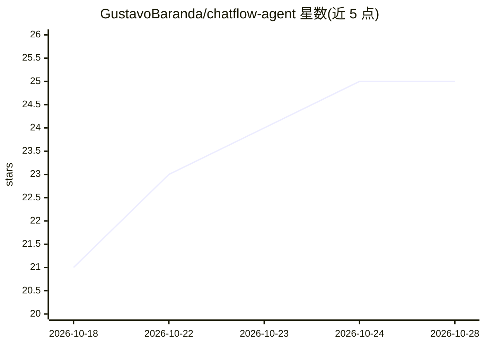

# GustavoBaranda/chatflow-agent

⭐ 25 · Python · MIT · 推送 2026-10-27 · [GitHub](https://github.com/GustavoBaranda/chatflow-agent) · [官网](https://pypi.org/project/chatflow-agent/) · 个人维护

**面向 WhatsApp/Telegram/Webhook 的轻量异步多智能体框架**

Python 编写的多智能体编排框架，仅 2 个运行时依赖（pydantic、httpx），提供 WhatsApp（Meta Cloud API）、Telegram、FastAPI Webhook 与 CLI 四类通道连接器。支持 Gemini、Gemma（本地 Ollama）、Grok、OpenAI、Claude 多提供商切换，内置基于 SQLite 的会话存储、agent 间自主转交、HMAC webhook 安全、自动重试与回合回滚。面向构建生产级对话智能体的开发者；Vertex AI 不被支持，并发锁保证范围限于单进程单事件循环。

## 筛选速览

| 维度 | 判定 | 备注 |
|---|---|---|
| AI 角色 | `ai-ecosystem` | LLM/agent 周边工具 |
| 许可风险 | `permissive` | MIT |
| 部署形态 | `library` | 以包/库形式分发 |
| 模型依赖 | local-ok | 支持本地模型 |
| 硬件要求 | — | 无带数字的原话,不猜 |
| 安装摩擦 | `low` | 无编译、无系统依赖或容器化 |
| 成熟度 | — | 结构信号不足 |

## 能力要点

- WhatsApp/Telegram/Webhook/CLI 全通道连接器
- 单一参数切换 Gemini/Gemma/Grok/OpenAI/Claude 提供商
- SQLite 会话存储与会话级并发锁、回合超时回滚
- Meta Anti-500 防重试风暴机制

## 适用场景

- 在 WhatsApp 或 Telegram 上部署多智能体客服/助理
- 本地 Ollama 跑 Gemma 实现零 API 成本的离线对话 agent
- Webhook 场景下构建具备回退与重试保护的生产级机器人

## 场景标签

`Agent 框架` `多智能体` · 领域:Agent 开发

## 证据(README 行号)

> L10: > **Build autonomous multi-agent swarms for WhatsApp, Telegram, and Webhooks in seconds without heavy dependency ch
> L25: * **Multi-Provider Freedom:** Switch between **Google Gemini**, **Google Gemma (100% free local via Ollama)**, **xA
> L46: `chatflow-agent` is designed for developers who want the multi-agent power of OpenAI Swarm without being locked int

## 星数曲线

2026-10-18 21 → 2026-10-28 25（+4）

---
*卡片 v1 · prompt 1.4 · 生成 2026-10-27 · 置信度 high · 依据 README sha `369649582664` · [字段定义](../../DATASET.md)*
