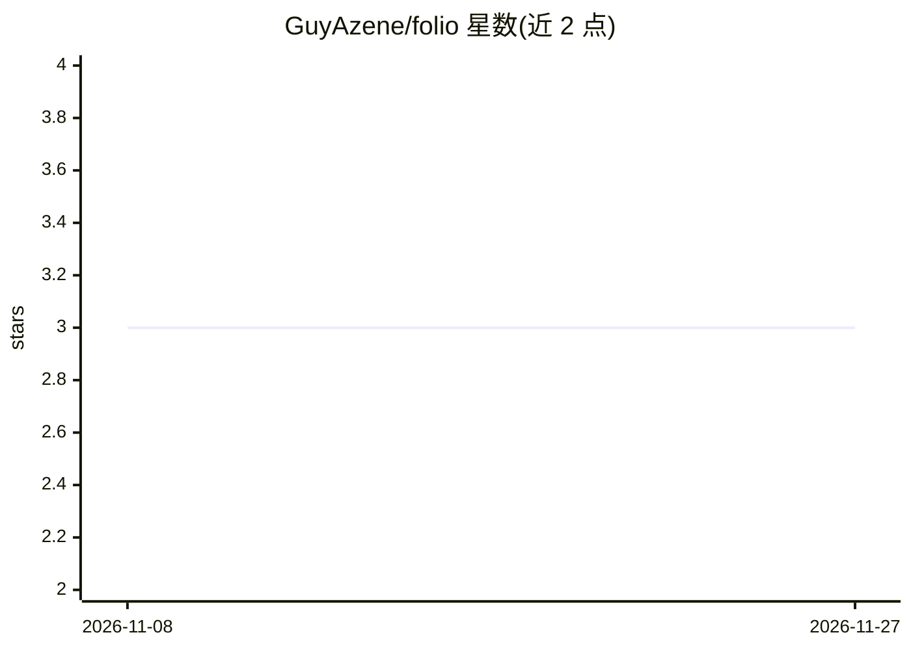

# GuyAzene/folio

⭐ 3 · TypeScript · MIT · 推送 2026-11-26 · [GitHub](https://github.com/GuyAzene/folio) · [官网](https://github.com/GuyAzene/folio/releases/latest) · 个人维护

**本地优先的桌面课程学习空间，内置基于课程内容的 AI 导师**

面向 Mac 与 Windows 的 Electron 桌面学习应用：将课件 PDF、讲义、作业与个人笔记集中管理，文件只读复制、不改动原件。AI 导师仅基于该课程的页面回答并引用出处，可把逐页图像（含图表）纳入阅读；支持把讲义逐页整理为按主题组织的引用出处学习笔记，导师回复内可渲染 Mermaid 图与交互演示。导师通过 ChatGPT 账号登录或用户自备 API key 运行；可接入 MCP 服务器（每次调用前需确认）。应用本身不内置模型推理，需 ChatGPT 套餐或 API key。

## 筛选速览

| 维度 | 判定 | 备注 |
|---|---|---|
| AI 角色 | `ai-native` | 本体是模型或模型工具 |
| 许可风险 | `permissive` | MIT |
| 部署形态 | `desktop` | 安装包/桌面程序 |
| 模型依赖 | — | README 未给出锁定关系 |
| 硬件要求 | — | 无带数字的原话,不猜 |
| 安装摩擦 | `low` | 无编译、无系统依赖或容器化 |
| 成熟度 | `idea` | |

## 能力要点

- 课程内问答引用所读页面， tutor 以图像形式读取页面（含图表与手绘自动机）
- 讲义逐页整理为按主题归档、逐条引用出处的学习笔记
- 支持自编 SKILL.md 例程与 MCP 服务器接入，工具调用前逐次确认
- 数据全部存于本地 ~/.folio，删除项保留 30 天回收站

## 适用场景

- 把一门课的课件、作业和笔记放在一个本地工作区里学习
- 对着课件提问并要求回答引用出处
- 把讲座自动整理成按主题组织、带引用的学习笔记
- 连接学校 Moodle 的 MCP 服务器让导师调用其工具

## 场景标签

`知识库管理` `文档问答` · 领域:知识与检索

## 证据(README 行号)

> L3:  A local-first study workspace for Mac and Windows, with a tutor that reads your course with you.
> L33: - **A tutor grounded in your course.** A course chat reads only that course and cites the pages
> L150: that registration, so ChatGPT's settings list one Folio. To use your own API key for OpenAI, Anthropic, Google Gem

## 星数曲线

2026-11-08 3 → 2026-11-27 3（+0）

---
*卡片 v1 · prompt 1.4 · 生成 2026-11-22 · 置信度 high · 依据 README sha `faceabf76fdc` · [字段定义](../../DATASET.md)*
