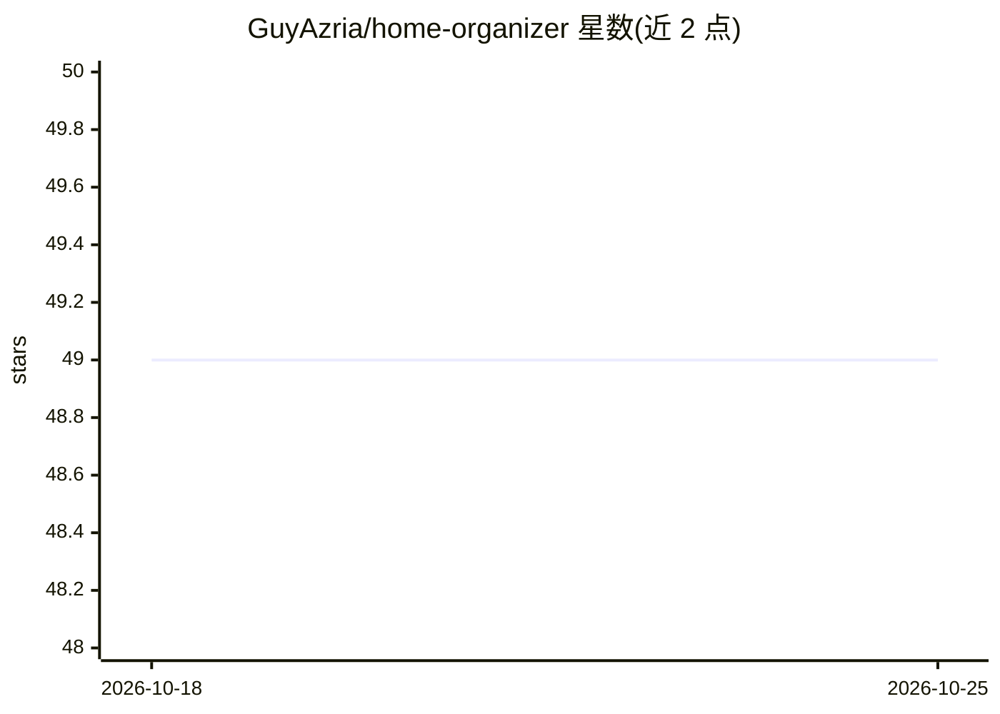

# GuyAzria/home-organizer

⭐ 49 · Python · GPL-3.0 · 推送 2026-10-22 · [GitHub](https://github.com/GuyAzria/home-organizer) · 个人维护

**Home Assistant 家庭库存管理面板，含 AI 语音助手**

Home Organizer 是 Home Assistant 侧边栏的全屏应用，管理家庭物品库存：嵌套文件夹、库存跟踪、收据扫描（价格与到期跟踪）、条码扫描。AI 部分通过 HO-AI 集成提供，支持云端（Gemini、OpenAI、Claude）与本地（Ollama、LM Studio）模型，配置为 HA 对话代理后可用自然语言添加物品、管理购物清单、设置提醒与日历。附可选的开源 Android 配套应用 HO_Mind_AI，提供蓝牙耳机按键唤醒、语音输入与相机扫描，经 HACS 安装，全程 UI 操作无需 YAML。

## 筛选速览

| 维度 | 判定 | 备注 |
|---|---|---|
| AI 角色 | `ai-enhanced` | 去掉 AI 部分产品仍成立 |
| 许可风险 | `viral` | GPL-3.0 |
| 部署形态 | `desktop` | 安装包/桌面程序 |
| 模型依赖 | local-ok | 支持本地模型 |
| 硬件要求 | — | 无带数字的原话,不猜 |
| 安装摩擦 | `low` | 无编译、无系统依赖或容器化 |
| 成熟度 | — | 结构信号不足 |

## 能力要点

- 嵌套文件夹家庭库存、库存跟踪与收据扫描（价格/到期）
- 云端与本地 AI 处理模式（Gemini/OpenAI/Claude/Ollama/LM Studio，含 Hybrid 混合模式）
- 设为 Home Assistant 对话代理后自然语言语音管理库存、购物清单、提醒与日历
- 可选 Android 应用 HO_Mind_AI：蓝牙耳机按键唤醒、摇晃唤醒、语音转写与相机扫描

## 适用场景

- 记录和管理家里各房间的物品库存与保质期
- 语音让助手把物品放入指定位置或加入购物清单
- 扫收据自动登记价格与到期信息
- 通过 HA Assist 在任意设备上语音控制灯光与查询库存

## 场景标签

`语音 Agent` · 领域:对话与助手

## 证据(README 行号)

> L5:  The complete AI-powered home inventory & smart voice assistant system for Home Assistant
> L17: Home Organizer is a dedicated full-screen application for your Home Assistant sidebar. It manages your home invento
> L19: **Talking to it in plain language happens through Home Assistant's own conversation agent** — set HO-AI as your ass

## 星数曲线

2026-10-18 49 → 2026-10-25 49（+0）

---
*卡片 v1 · prompt 1.4 · 生成 2026-10-25 · 置信度 high · 依据 README sha `20cae880add7` · [字段定义](../../DATASET.md)*
