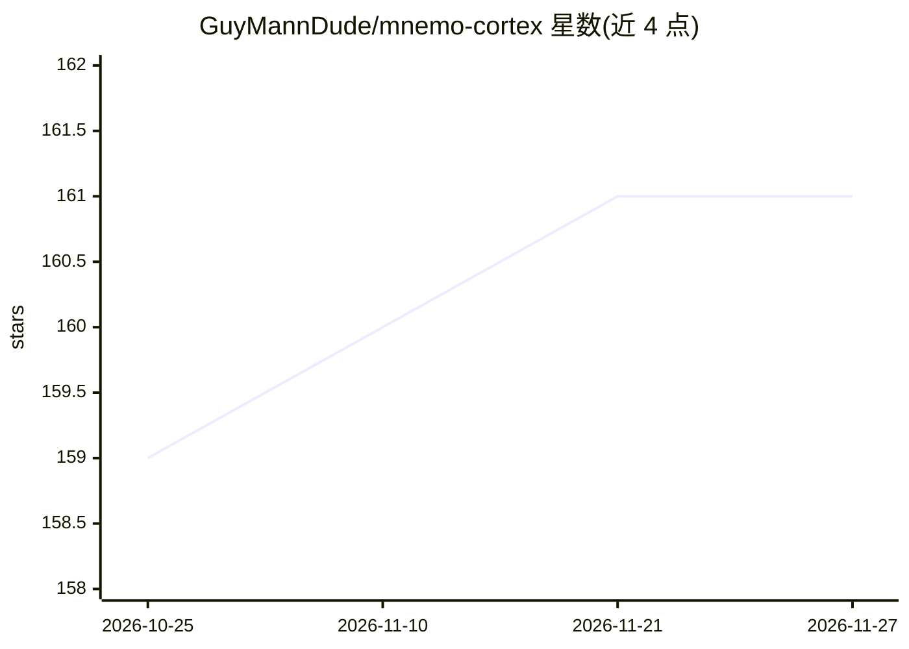

# GuyMannDude/mnemo-cortex

⭐ 161 · Python · MIT · 推送 2026-11-24 · [GitHub](https://github.com/GuyMannDude/mnemo-cortex) · [官网](https://projectsparks.ai) · 个人维护

**给 AI agent 提供持久化本地记忆的 MCP 服务器**

以 MCP 服务器形式运行的本地优先记忆层：为 agent 提供跨会话持久记忆、语义检索、跨 agent 记忆共享、隔夜整合（dreaming）、带置信度阶梯的键值事实库与 USB 加密离线同步。通过 stdio MCP 接入 Claude Code/Claude Desktop 等客户端，ChatGPT 走带鉴权的 REST 网关接入。安装指引集中在 INSTALL.md，另提供 .mcpb 一键包与非交互式 robot-install 脚本。作者自述为个人开发者，靠捐助维持，无云端依赖。

## 筛选速览

| 维度 | 判定 | 备注 |
|---|---|---|
| AI 角色 | `ai-ecosystem` | LLM/agent 周边工具 |
| 许可风险 | `permissive` | MIT |
| 部署形态 | `library` | 以包/库形式分发 |
| 模型依赖 | local-ok | 支持本地模型 |
| 硬件要求 | — | 无带数字的原话,不猜 |
| 安装摩擦 | `low` | 无编译、无系统依赖或容器化 |
| 成熟度 | — | 结构信号不足 |

## 能力要点

- MCP 服务器形式，支持 stdio 传输的任意本地 MCP 客户端
- 双层记忆分类：Smart Notes 与 Session Logs 分层召回
- 键值事实库带三态置信度追踪与防篡改 Memory Ledger
- USB 离线同步（可选 AES-256），无云端依赖

## 适用场景

- 让 Claude Code 或本地 LLM 客户端跨会话记住上下文
- 多 agent 之间共享记忆与消息（Disco-Bus）
- 在不暴露服务器的条件下给 Custom GPT 接入自有记忆

## 场景标签

`Agent 记忆` · 领域:Agent 开发

## 证据(README 行号)

> L9: MCP server
> L84: Mnemo Cortex gives AI agents persistent, local, cross-agent memory. It captures what happened, recalls what matters
> L127: **Supported:** Claude Code, Claude Desktop, OpenAI Codex CLI, and **any local MCP client that speaks stdio transpo

## 星数曲线

2026-10-25 159 → 2026-11-27 161（+2）

---
*卡片 v1 · prompt 1.4 · 生成 2026-11-27 · 置信度 low · 依据 README sha `c40213c592be` · [字段定义](../../DATASET.md)*
