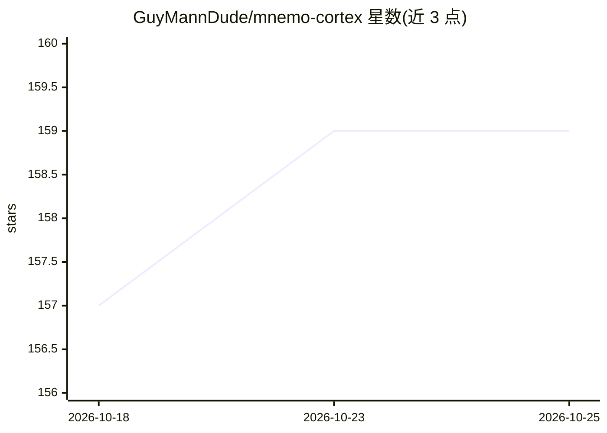

# GuyMannDude/mnemo-cortex

⭐ 159 · Python · MIT · 推送 2026-10-25 · [GitHub](https://github.com/GuyMannDude/mnemo-cortex) · [官网](https://projectsparks.ai) · 个人维护

**给 AI agent 的本地持久记忆 MCP 服务器：语义检索与跨 agent 共享**

为 AI agent 提供本地运行的持久记忆层，以 MCP 服务器形式接入 Claude Code/Desktop、ChatGPT（经网关）及 LM Studio、Ollama 等本地客户端。核心机制包括：两层分级存储（蒸馏笔记与原始会话日志，分类失败回退正则标签器）、夜间跨 agent 整合（dreaming）、SQLite FTS5 文档索引、带置信度阶梯的结构化事实存储、防篡改记忆账本，以及加密 USB 离线同步。作者声明由个人开发者维护，无云端依赖、无遥测。部分功能（Developer's Passport）标注 beta，Thesaurus Loop 在开发中。

## 筛选速览

| 维度 | 判定 | 备注 |
|---|---|---|
| AI 角色 | `ai-ecosystem` | LLM/agent 周边工具 |
| 许可风险 | `permissive` | MIT |
| 部署形态 | `library` | 以包/库形式分发 |
| 模型依赖 | local-ok | 支持本地模型 |
| 硬件要求 | — | 无带数字的原话,不猜 |
| 安装摩擦 | `low` | 无编译、无系统依赖或容器化 |
| 成熟度 | `idea` | |

## 能力要点

- 两层记忆分级：LLM 分类的 Tier-1 笔记优先召回，会话日志默认排除
- 夜间 dreaming 整合与 agent 间消息总线（Disco-Bus，A2A 兼容）
- 加密 USB 同步（可选 AES-256，密钥不存于 U 盘）
- ChatGPT 经加固双路由网关接入，服务器不暴露公网

## 适用场景

- 让本地或云端 AI 助手跨会话记住我的偏好与工作上下文
- 多 agent 之间共享记忆与事实
- 无网络环境下用 U 盘在两台机器间同步 agent 记忆

## 场景标签

`Agent 记忆` `多智能体` · 领域:Agent 开发

## 证据(README 行号)

> L84: Mnemo Cortex gives AI agents persistent, local, cross-agent memory. It captures what happened, recalls what matters
> L127: **Supported:** Claude Code, Claude Desktop, OpenAI Codex CLI, and **any local MCP client that speaks stdio transpo
> L129: **ChatGPT: supported via a gate, not MCP.** ChatGPT has no local/stdio MCP — its connectors call out from OpenAI's

## 星数曲线

2026-10-18 157 → 2026-10-25 159（+2）

---
*卡片 v1 · prompt 1.4 · 生成 2026-10-23 · 置信度 high · 依据 README sha `62cc05e2d36e` · [字段定义](../../DATASET.md)*
