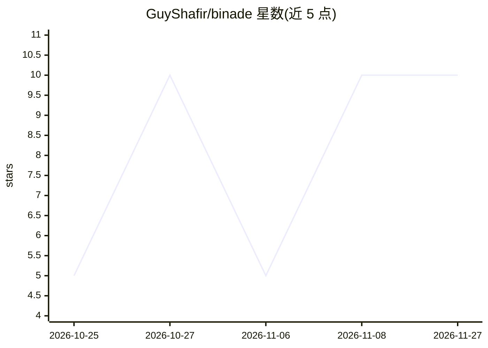

# GuyShafir/binade

⭐ 10 · Python · Apache-2.0 · 推送 2026-11-26 · [GitHub](https://github.com/GuyShafir/binade) · [官网](https://huggingface.co/Binade) · 个人维护

**BF16 LLM 权重无损压缩与加载运行库，输出逐位一致**

针对 BF16 大模型权重的无损压缩工具：保留符号与尾数为原始字节，将 8 位指数替换为按张量频率排名表并以 Rice 码存储（约 10.75 bits/权重），加载时转为 4 位运行时布局供 Metal 内核直接读取。提供 binade pack/unpack/serve 子命令，可通过 mlx-lm 加载推理并以 OpenAI 兼容 HTTP API 服务，还可从 Hugging Face Hub 直接载入已发布的 Binade 模型。限制：精确性绑定 MLX 0.32.2 内核版本，融合 GEMM 仅在 M3/M4 GPU 启用，视觉与音频权重只打包不参与运行时服务。

## 筛选速览

| 维度 | 判定 | 备注 |
|---|---|---|
| AI 角色 | `ai-ecosystem` | LLM/agent 周边工具 |
| 许可风险 | `permissive` | Apache-2.0 |
| 部署形态 | `library` | 以包/库形式分发 |
| 模型依赖 | — | README 未给出锁定关系 |
| 硬件要求 | — | 无带数字的原话,不猜 |
| 安装摩擦 | `medium` | 含编译或系统依赖之一 |
| 成熟度 | — | 结构信号不足 |

## 能力要点

- 指数频率排名 + Rice 码存储，压缩后输出与原模型逐位一致（bit-exact）
- 支持 Apple Silicon（MLX/Metal）与 NVIDIA GPU（MLX CUDA 后端）
- binade pack/unpack 可双向转换，unpack 逐位重建原始 BF16 checkpoint
- binade serve 兼容 mlx_lm.server 选项，可在压缩/未压缩模型间切换

## 适用场景

- 在 48GB Mac 上加载原 BF16 放不下的模型权重
- 为推理服务降低权重磁盘占用与常驻内存
- 需要与未压缩模型输出完全一致的无损压缩方案

## 场景标签

`模型量化` · 领域:训练与推理

## 证据(README 行号)

> L5: Bit-exact compression of BF16 LLM weights for Apple Silicon (MLX), and for NVIDIA GPUs through MLX's CUDA backend.
> L7: A BF16 weight keeps its sign and mantissa as one raw byte. Its 8-bit exponent (the weight's binade) is replaced by i
> L92: binade serve --model Binade/gemma-4-12B-it --port 8080

## 星数曲线

2026-10-25 5 → 2026-11-27 10（+5）

---
*卡片 v1 · prompt 1.4 · 生成 2026-11-20 · 置信度 high · 依据 README sha `f069be37a491` · [字段定义](../../DATASET.md)*
